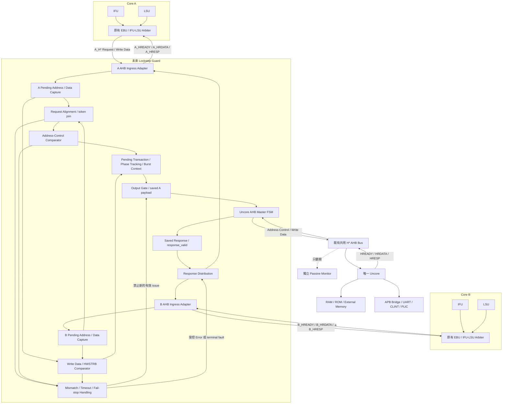

# Step 3A：Dual-Core Lockstep Architecture Design

## 0. 狀態、範圍與設計結論

**本文件全部屬於設計計畫，沒有實作或執行 Step 3 測試。** 本次只新增本文件，不修改 RTL、Monitor、Testbench、Config，不 Commit、不 Push，不覆蓋任何既有產物。

已完成並驗證的成果：

| Step | Branch／Checkpoint | 已驗證範圍 |
|---|---|---|
| Step 1 | `aebe53d12a1003791bd8f3d8823635aaa3d0330e` | A-only Passive Monitor |
| Step 2 | `ahb-shared-guard-step2`／`8ff5bf2471d51e45a3317768e04aac4bb97d3ee0` | A-only Shared Guard 透明直通、獨立 Testbench、Burst Stall、Hello Wally 與 Step 1 Waveform 一致 |
| Step 3A | 本文件；仍位於 Step 2 Branch | Design Only；尚無 Core B、Comparator、Output Gate 的實作或測試結果 |

本設計推薦建立 **兩個獨立的 AHB slave-facing Ingress Adapter、一個 Pair Alignment、一個 Compare-before-issue Output Gate，以及一份 Response 的雙向分送**。正常路徑每個 matched beat 只執行一次外部存取。

兩個必要結論：

1. **不能先把 A/B HREADY 都拉低，再等待兩者 HTRANS 出現。** 實際 busfsm/buscachefsm 在初始 Address Phase 用 HREADY 產生 HTRANS，會造成循環等待。
2. **不能先送出 Write Address，再等 Write Data 比較完畢才決定是否放行。** 已接受 Address 的 slave 可能在隨後 Data Phase 產生 Side Effect。安全版本必須先在上游接受 Address、取得並比較 Write Data，再向 Uncore 發送該筆 Address。

這代表 Step 3 主動 Guard 需要 Pending Register、分離的上／下游 handshake 與額外 latency；不能繼續宣稱 Step 2 的逐周期組合透明性。外部 AHB 仍用原有訊號，不另創 Core-facing Request/Response ports。

## 1. 實際 RTL 證據索引

以下行號指向目前 Step 2 Checkpoint 的原始檔案；這些都是本次已閱讀的 RTL，不是待實作功能。

| 檔案與行號 | 實際行為／設計意義 |
|---|---|
| `src/wally/wallypipelinedsoc.sv:78,90–106,116–136` | 共同 reset synchronizer、Core A、A-only Shared Guard、下游 Monitor、唯一 Uncore |
| `src/wally/wallypipelinedcore.sv:30–48` | Core 接收 clk/reset、Interrupt、MTIME_CLINT、AHB Response，輸出一組 AHB |
| `src/wally/wallypipelinedcore.sv:260–275` | 每個 Core 自己實例化 EBU；BUS_SUPPORTED=0 的輸出置零 |
| `src/ebu/ebu.sv:90–91,100–128` | HCLK=clk、HRESETn=~reset；IFU/LSU controllerinput、Mux、ebufsmarb；Write Data 來自 LSU |
| `src/ebu/controllerinput.sv:67–84` | IFU Save/Restore；Request=(HTRANSOut!=00)，HREADYOut=HREADYIn & ~Disable |
| `src/ebu/ebufsmarb.sv:67–94,100–121` | LSU priority、IFU Save/Restore、IFUReqDelay、依 HREADY 更新 Burst 計數 |
| `src/ebu/busfsm.sv:63–73,86–90` | 初始 HTRANS 依賴 HREADY；Data Phase 等 HREADY；CaptureEn 在 DATA_PHASE 可持續為 1 |
| `src/ebu/ahbinterface.sv:58–63` | Read FetchBuffer；無 Cache LSU 的 Write Data/Strobe 每拍延遲暫存，沒有 HREADY enable |
| `src/ebu/ahbcacheinterface.sv:87–97,112–128` | Read beat buffer、BeatCount 地址；Write Data/Strobe 以 HREADY 啟用暫存 |
| `src/ebu/buscachefsm.sv:90–110,118–147,149–160` | HREADY 推進 FSM/BeatCount；產生 NONSEQ/SEQ/Burst；目前 rv64gc 可產生 INCR8 |
| `src/ifu/ifu.sv:266–332,365–367` | private IROM/I-Cache/Bus 路徑；PC 由 P.RESET_VECTOR 初始化 |
| `src/lsu/lsu.sv:321–400` | private D-Cache、uncached access、cache writeback、AHB interface |
| `src/cache/cacheway.sv:151–175` | ValidBits reset；DirtyBits 沒有同樣的 reset；必須按 valid 語義判讀 |
| `src/cache/cacheLRU.sv:138–148` | LRU Memory reset；Cache 更新歷史會影響替換 |
| `src/hazard/hazard.sv:82–101` | IFU/LSU Stall 傳播；ExternalStall 是 pipeline Stall 原因，不是完整 Core clock freeze |
| `src/privileged/csrm.sv:156–157` | MHARTID hardwired 0，兩個 replica 預設都相同 |
| `src/privileged/csrc.sv:103,139–157,195` | MCYCLE 隨 clk 更新；TIME CSR 直接讀 MTIME_CLINT，繞過 AHB |
| `src/privileged/csri.sv:80–91` | MIE 私有狀態及 Interrupt pending 輸入 |
| `src/privileged/trap.sv:65–70` | Interrupt 是否成立依各 Core 的 Committed、InstrValidM 等狀態 |
| `src/privileged/csrs.sv:130–134` | 若 SSTC enabled，STimerInt 由私有 STIMECMP 與 MTIME_CLINT 比較 |
| `src/uncore/uncore.sv:100–109,189–214` | slave decode、AHB-APB bridge、Response Mux、HREADY-enabled delayed select |
| `src/uncore/ram_ahb.sv:54–74,76–108` | Address acceptance、延遲 Write Enable、RAM 寫入與可配置 RAM_LATENCY |
| `src/uncore/ahbapbbridge.sv:64–86,101–104` | 接受 Address 後保存選擇，稍後進入 APB access；HWDATA/HWSTRB 直接到 PWDATA/PSTRB |
| `src/uncore/uart_apb.sv:51–60` | memwrite=PWRITE&PENABLE&PSEL；Din=PWDATA[7:0]，memwrite 沒有用 PSTRB 遮罩 |
| `src/uncore/clint_apb.sv:95–103,150–153` | MTIME 隨 PCLK 增加，產生一組 MTimerInt/MSwInt；不是每個 replica 一個 CLINT |
| `testbench/testbench.sv:540–593,687–695` | private IROM 和 shared RAM 的不同載入路徑；原有 SoC 實例與時脈 |

後文的模組名、Register、FSM、時序表均是建議設計；上述檔案中尚無這些 Step 3 控制。

## 2. 三種功能必須分開

| 功能 | 簡單說明 | 本專題的位置 |
|---|---|---|
| IFU/LSU Arbitration | 同一顆 Core 的取指與資料存取輪流用自己的出口 | 每個 Core 內的原有 EBU／ebufsmarb，保留兩份 |
| 一般 Core A/B Multi-Master Arbitration | A/B 執行不同工作，各自 Request 都要執行，Arbiter 決定先後 | 不是本次 Lockstep 的目標 |
| Dual-Core Lockstep | A/B 是同一個 logical hart 的兩份 replica；對應 Request 必須一致，外部效果只做一次 | Pair Alignment、Comparator、Output Gate、Response Distribution |
| Comparator | 比較已對齊、同一 token 的內容 | 不決定公平排程，不等於 Arbiter |

Lockstep 下 B 的 Request 是第二份比對證據，不能再對 UART/RAM 執行一次；但是 B 在自己的 AHB 介面仍是合法 master，Guard 必須提供完整 Address/Data handshake 與 Response。

只比 AHB 邊界不等於比較所有退休指令或內部狀態：Cache hit、暫存器計算或私有記憶體的錯誤可能尚未顯現在 Bus。也不能偵測兩個 Core 共同依賴的同一份錯誤 Memory Response。完整 architectural Lockstep coverage 需另有 retirement/internal-state 比較設計；本文件先處理 Bus-boundary Lockstep。

## 3. Core B Integration

### 3.1 SoC 實例與接線計畫

未來在 SoC 保留現有 A 的 instance 名稱 `core`，新增 `core_b`，兩者使用相同 `P`。保留 `core` 可減少原 Testbench 對 `dut.core...` 的既有階層依賴。

A、B 各自輸出完整的 A_H*/B_H*；各自接收 A_HRDATA/A_HREADY/A_HRESP 與 B_HRDATA/B_HREADY/B_HRESP。不能將 A/B 的 request outputs 接成同一條 wire，也不能讓兩個 Core 的 HCLK/HRESETn outputs 同時驅動共用線。

| 項目 | A/B 共用方式 | 注意事項 |
|---|---|---|
| clk | 同一個 SoC clk | 初期不做 clock gating、相位偏移或 CDC |
| reset | 同一個 synchronizer 的 reset，兩者同緣解除 | 不各自同步外部 reset；Guard 清除兩側 Pending 與 epoch |
| HCLK/HRESETn | A 的既有 outputs 繼續作共用來源；B outputs 接獨立 B_HCLK/B_HRESETn | 只驗證 B outputs 與共同來源相等，不並接 outputs |
| ExternalStall | 同一既有外部輸入 | 不當作任意 freeze Core 的通用工具；AHB FSM/Counter 不全由它 enable |
| MTimerInt/MSwInt | 同一 Uncore CLINT 輸出廣播 | 一個 logical hart，不新增第二份 timer compare state |
| MExtInt/SExtInt | 同一 Uncore PLIC 輸出廣播 | PLIC claim/read 有 Side Effect，必須單次執行並分送 Response |
| MTIME_CLINT | 初期同一個共同輸入 | 同 wire 不保證不同 logical instruction 在不同 cycle 讀到相同值，見後文 |
| RAM/Boot ROM/Peripheral/外部 Memory | 同一份 Uncore，一個受控 AHB master | A/B 都經 Guard，不各自直接讀 UART/FIFO |
| I-Cache/D-Cache/TLB/CSR/branch predictor | 各 Core 私有 replica | 相同配置、reset 與初始有效狀態；不是直接共用一份 Cache |
| IROM/DTIM 若啟用 | 每個 Core 內各有一份 | Testbench 必須載入同一映像並確認一致，不能只載入 A |

目前 rv64gc：BUS_SUPPORTED=1、I/D-Cache enabled、各 512-bit line、RESET_VECTOR=0x80000000、IROM/DTIM disabled、BURST_EN=1（config.vh:116–133,149,157–169,203）。AHBW=64 時一條 512-bit cache line 對應 INCR8。

### 3.2 如何執行相同程式

兩者相同 P、RESET_VECTOR、Reset、ISA/CSR 初始狀態；shared RAM 載入同一 ELF 一次。兩者取得同一筆 shared read 的同一份資料，包含 instruction refill、load、MMIO status 與有讀取 Side Effect 的資料。

MHARTID 目前 hardwired 0；Lockstep 中兩個 replica 應維持同一 logical hart identity，不能為 B 改成 1 然後期待程式行為相同。這和兩個獨立軟體 hart 的 multi-core 系統不同。

各 Core 仍自己實例化 EBU 與原有 IFU/LSU Arbitration，不把兩顆 Core 的 IFU/LSU 合併進同一個 ebufsmarb。

### 3.3 Determinism 的限制

相同程式加相同 Bus Response，不足以保證任意 Cycle Skew 下的完全相同行為：

- A/B 在不同 wall-clock cycle 執行 TIME/MCYCLE CSR read，可能取得不同值；AHB Guard 無法攔截 csrc 的私有 CSR read。
- 同一 Interrupt wire 到兩者，不代表在同一 logical instruction 邊界被接受；trap.sv 還檢查各自 Committed/InstrValidM。
- 私有 Cache/TLB/branch predictor 歷史若不同，可能一邊 hit、一邊 miss，或 EBU 的 IFU/LSU 順序不同。
- DirtyBits/資料陣列不全 reset；不得以 Verilator 的二態零初始結果當作完整硬體初始化證明。有效位與未使用資料必須區分。
- ExternalStall 不會停止全部 AHB/CSR/Cache state，不能直接用「停住 A、等 B 追上」保證 architectural resynchronization。

初期 real-core bring-up 應採相同時脈、相同 reset、相同 Response release cycle、受控 Interrupt，程式先避免 TIME/MCYCLE 等結果影響控制流程。不同 cycle 的 Request Alignment 可先由 synthetic AHB agents 驗證，再量測兩個實際 Core 是否仍保持相同 transaction order。

本設計只承諾在**相同有序 Request stream、有界 arrival skew、兩側遵守 AHB、shared slave 最終完成**的假設下，設計上可避免 handshake 自己造成的 Deadlock。無法只靠 Bus Guard 保證任意 skew、任意 Interrupt、任意程式都維持 Lockstep。

## 4. Guard 完整 Block Diagram

Monitor 不提供任何 match/allow/valid/timeout/FSM 控制。移除或關閉 Monitor，Guard 的功能必須不變；Debug assertions、scoreboard 也不能成為產品資料流依賴。

## 5. Request Alignment 與上游 AHB handshake

### 5.1 三個「接受／完成」要分開

| 事件 | 定義 | 不代表什麼 |
|---|---|---|
| `up_accept_X` | 上升緣前 X_HREADY=1 且 X_HTRANS[1]=1 | 不代表 Memory 已執行，也不代表這筆 Data Phase 完成 |
| `down_accept` | 上升緣前共用 HREADY=1 且 Gate 輸出 HTRANS[1]=1 | 只是 Uncore 接受 Address，Response 尚未回來 |
| `up_complete_X` | X 有先前已接受的 Data Phase，且 X_HREADY=1 | 不要求當前 X_HTRANS 有效；當前可能是 IDLE 或下一筆 Address |

AHB 的同一個 HREADY 同時推進前筆 Data Phase 與當前 Address Phase。不能設計成只有單一「Request done」旗標。

### 5.2 每側一個 Pending beat，Response release 同時可接受下一個 Address

每側保留：pending_valid、saved_addr_control、local_seq、need_wdata_capture、wdata_valid、saved_wdata/saved_strb。初期最多一個未完成 Data Phase，不先做多深 FIFO。

- **空 slot 且沒有待回 Data Phase：X_HREADY=1。** 這個 ready 由空間/狀態決定，不依賴 X_HTRANS 或 peer_match，也不依賴下游 HREADY。
- 在 up_accept_X 保存 Address/Control，該側下周期進入 Pending，X_HREADY=0。
- peer 尚未出現時，它的空 slot 仍保持 ready=1，讓它的 HREADY-dependent HTRANS 有機會出現。
- Write 的 Data 在 Address 接受後的下一個 Data Phase 才有效；在後續上升緣擷取，即使當時 X_HREADY=0。這是保存 stalled Data，不是提前宣告完成。
- Read 的 pending metadata 不要求 Write Data valid。
- Pair 由 A/B 的 FIFO head local_seq 配對；不看 live address 尋找任意相同內容，也不跳過不一致 head。
- Response release 時 A/B 同緣完成舊 Data Phase，同緣可能接受下一筆 Address。用舊 metadata 完成舊 token，用新輸入更新新 token，不能先清空後丟掉新 Address。

從 Register 角度，一個 slot 可以在 release edge 被下一筆覆寫；Response payload 必須在獨立 rsp_q，不能跟著 slot 覆寫而變成下一筆資料。

### 5.3 A 先到、B 還沒到

A 的 Address 可先被本地 Adapter 接受，保存後 A_HREADY=0；B 的空 Adapter 保持 B_HREADY=1。B 到達後亦保存 Address，再比較這兩份已保存的同一 ordinal Request。

此時 Memory 尚未看到有效 Address。B 不會被要求先「等 shared response」才有 ready，因此沒有 peer-to-peer ready 依賴。

A/B arrival time 不同只形成 WAIT_PEER；不能立刻判定 Mismatch。timeout 是可配置 diagnostic，超過門檻表示 ALIGNMENT_TIMEOUT，並非數學上證明兩個 Request 的內容不同。

### 5.4 須避免的 Deadlock

禁止以下方程式／規則：

- X_HREADY = both_requests_visible & match，因為 HTRANS 初始又依賴 HREADY。
- B_HREADY 永遠為 0，因為 B 沒有直接連 Uncore。
- A_HREADY 依 B_HREADY、B_HREADY 又依 A_HREADY 的組合互等。
- 等 Write Data Match 才接受上游 Write Address，因為合法的 Data 要在 Address 被接受後才產生。
- 先收完整 Burst 再回任何 upstream completion；Core 必須靠每個 HREADY beat 才推進 Burst，會彼此等待。
- 從當前 shared HREADY 直接產生所有上游 ready；上游接受與下游接受已是不同時間點。

建議 Ingress ready、Output Gate valid 由 registered FSM/slot state 產生，不由 peer live signals 形成長組合圈。下游 HREADY 為 Uncore 的 Response，Guard 不可強行驅動或假造它。

### 5.5 Cache、Burst、Interrupt 引發的順序變化

Guard 能容忍同一 ordered stream 的 arrival skew，不能自動把不同的 EBU stream 重新排序成同一程式。

例如 A 先出 IFU refill、再出 LSU load，B 因 Cache 或 pipeline 時機先出 LSU load、再出 IFU refill，兩顆 Core 可能仍有相同的高階程式目的，但 Bus stream 已不同。初版應標記 ORDER/STRUCTURAL_DIVERGENCE，停止輸出；不可搜尋後面的 matching address 然後跳過 MMIO，亦不可將其武斷歸類為 CPU data fault。

若必須容忍這種重排序，需要更高層的指令／存取識別、分開 IFU/LSU streams 或 retirement alignment，會超出保留原 Core 介面的初版範圍。

## 6. Comparator

### 6.1 Address/Control 比較

同一 epoch/local_seq 的兩個有效 Pending 比較：HADDR、HWRITE、HSIZE、HBURST、HPROT、HMASTLOCK、HTRANS（NONSEQ/SEQ 語義），以及 Guard 自己的 Burst index/context。

HPROT 不能當 Core ID：原 EBU 的 HPROT[0] 表示 IFU/LSU instruction/data 選擇（ebu.sv:119）。它的差異可能表示兩側對齊了不同來源的交易。

HCLK/HRESETn 是共同前提，不放在 payload comparator；HREADY 是各介面 handshake 控制，arrival skew 時可不同，不作 live equality mismatch。HRDATA/HRESP 是單份 slave Response 的 distribution，沒有第二次 Memory read 可用來獨立比較。

### 6.2 Write Data 與 HWSTRB 比較

只對已接受且 saved HWRITE=1 的 Data Phase，比較兩側已擷取的 saved_wdata/saved_strb。不得使用現在的 HWRITE 決定前一筆是否要比較。

**初版採完整 HWDATA 與完整 HWSTRB equality。** 不先採 masked-byte comparison：目前 uart_apb 的 memwrite 不使用 PSTRB，Din 固定取低 byte；不能假設每個看似 inactive lane 都不會被所有 slave 觀察。若未來要忽略 inactive bytes，必須先逐個 slave 證明 byte-lane 語義與資料複製規則。

Read 不比較無意義的 HWDATA/HWSTRB。四態 simulation 中有效欄位含 X/Z 時報 UNKNOWN_INPUT，不用 case equality 把兩份相同 X 當成合法 match。

### 6.3 HTRANS 處理

| HTRANS | Alignment／Comparator 行為 |
|---|---|
| NONSEQ | 有效 beat，開始新 Burst 或 SINGLE；保存並比較 |
| SEQ | 有效 beat，必須有對應 Burst context、相同 beat index/address/control |
| IDLE | 不建立 token，不比較其無效 Address/Data；可能與前一筆有效 Data Phase 重疊 |
| BUSY | 不建立 token，也不完成一個新的 beat；保留 Burst context，不當作 missing transaction |

注意原 controllerinput 的 Request 是 HTRANS!=00，連 BUSY 都算，而 Guard 的「有效 Address」應用 HTRANS[1]。兩者是不同層級的語義，不能複製錯公式。實際 buscachefsm 主要產生 NONSEQ/SEQ/IDLE；synthetic Testbench 仍需測 BUSY。

對合法 timing bubble，允許一側 BUSY/IDLE 暫時沒有新 token、另一側先進入 Pending；後續仍按有序有效 token 比較。Burst context 不能因每個 idle cycle 就任意被當成新 sequence；若來源真結束/重啟 Burst，之後 NONSEQ/SEQ/地址規則須可辨識為 protocol 或 stream divergence。

### 6.4 Mismatch 分類

- ADDRESS_MISMATCH、CONTROL_MISMATCH、WRITE_DATA_MISMATCH、WSTRB_MISMATCH。
- BURST_CONTEXT_MISMATCH／PROTOCOL_ERROR，例如沒有起始 token 的 SEQ。
- ORDER/STRUCTURAL_DIVERGENCE：head 對應無法成立，不能保證為單純算術錯誤。
- ALIGNMENT_TIMEOUT：peer 太晚或永遠沒來；和已證明的 payload inequality 分開。
- DOWNSTREAM_TIMEOUT：slave 不完成，不能怪 B。
- UNKNOWN_INPUT：有效欄位含未知值，僅 simulation 的分類方式另定。

先比較已保存 token，再判定不同；同一 pair 的 payload 不等才是內容 Mismatch。沒有 deadline 或更高層 identity 時，永遠無法僅靠 Bus 證明一顆尚未出現的 Request 是「晚到」還是「永遠不會來」。

## 7. Output Gate 與 Side Effect 安全

### 7.1 固定使用 A 的 payload 可以，但不是直接選 live A Bus

條件是 Address/Control Match，且若為 Write，兩份 Data/Strobe 也已 Match。Output Gate 選擇的是 **saved、已驗證的 A payload**，而不是此刻可能屬於下一筆的 A_HADDR/A_HWDATA。

每個 pair token 設 issue_once/down_addr_accepted，該 Address 的 HTRANS[1] 只在一次 down_accept 成立前保持有效；被接受後轉到 Data Phase，不在每個 HREADY 周期重送。

Read 亦只向 slave 執行一次，再將同一份 saved Response 給 A/B。UART receive/FIFO pop、PLIC claim 等 read 也有 Side Effect，不能讓 B 再讀一次。

### 7.2 為何只在 Data Phase 擋住寫入不夠

ram_ahb 在 Address 接受後保存 memwriteD，之後 `.we(memwriteD)` 送進 RAM（ram_ahb.sv:56–74）。AHB-APB bridge 也在 Address 接受後保存 PSEL/PWRITE，稍後 PENABLE 使 UART memwrite 成立。

因此 Write Data Mismatch 發現後才拉低上游 ready、改資料、清 strobe 或取消目前 HTRANS，都不能保證已接受的 slave 沒有 Side Effect。特別是 UART memwrite 沒看 PSTRB，清 strobe 不構成安全 Output Gate。

安全不變量：

- 任何下游有效 Write Address 被接受之前，對應 pair 的 Address/Control 與 Data/Strobe 已保存且比較成功。
- 下游使用已比較過的資料，不能再回到未鎖存 live data。
- 不能靠事後 Rollback 修復 UART byte/FIFO read；本設計沒有 Rollback。
- Reset 或 fault 發生在下游接受之後，已發生的合法 prefix Side Effect 不可撤回。Guard 的保證是「沒有放行尚未通過比較的 beat」，不是整個 Burst 原子性，也不是全系統 recovery。

RAM wait 期間可能重複對相同位置施加相同 write enable；「只執行一次」以一個外部 AHB transaction／一次 MMIO handshake 定義，不聲稱原 RAM 每個物理 write-enable pulse 都只有一拍。驗證要同時檢查 AHB acceptance 與真正 UART/APB/FIFO Side Effect 計數。

## 8. Response Distribution：核心設計

### 8.1 B_HREADY 如何產生

B_HREADY 是 Guard 作為 B 的 slave 所產生的完成/可接受訊號，不是 B 傳來的 ready，也不是只有 owner 才能獲得的 grant。

| B 側狀態 | B_HREADY | B_HRESP | B_HRDATA |
|---|---:|---:|---|
| 無 Pending、可收 Address | 1 | 0 | 定義的 idle 值，例如 0 |
| 已收 Address，等 peer/Data/Compare/Uncore | 0 | 0 | 可維持上次或 0，不能視為有效新 Response |
| 正常 pair Response release | 1 | 0 | saved_rsp_data；Read 在此緣完成 |
| Error replay 第一周期 | 0 | 1 | 保存的 error data，建議 0 |
| Error replay 第二周期 | 1 | 1 | 同上，完成已接受的 Data Phase |
| terminal fault 隔離 | 0 | 依 fault FSM | 不對未執行 Request 假造成功資料 |

A 同理。初版選擇 **兩側 Pending 都存在時，同一個 Response release cycle 同時完成**，不讓其中一側先拿 Response 往前跑。不需要 A/B 額外 acknowledge port；各自 pending && HREADY 的邊緣就是 consumed 事件。

### 8.2 B_HRDATA／B_HRESP 的來源

Uncore Data Phase 真正完成時，先保存 HRDATA/HRESP 到 rsp_q 並設 rsp_valid。之後獨立的 release cycle 把同一份 rsp_q 送給 A/B；不讓晚到的 B 直接看早已改成下一筆資料的 live HRDATA。

若 Uncore 回 Error，保存最終狀態並向兩側重建合法的兩周期 Error Response；不是只把最後一拍 HRESP=1/HREADY=1 突然廣播。外部 Error 的 HREADY=0 周期亦需在 down FSM 識別，但不要求上／下游 Error 發生在相同 wall-clock cycle。

重要限制：現有 EBU 接收 HRESP 但未使用（ebu.sv:56 及實際邏輯）。因此協定上回了 Error，不代表 Core 會正確 trap。初版若遇 slave Error，應 latch fault 並要求共同停止／reset，不能假設軟體可以透明恢復。

### 8.3 接受與完成、重複保護

每側 local_accept_count 只在 up_accept_X 增加。保存 token 後 ready=0，所以同一個被保持的 Request 不會被每拍重新接受。

slot 的釋放只在該 token 的 up_complete_X；下游 ready 或 peer 出現都不直接清除 slot。response_sent/consumed bits 確保同一 rsp_q 不會多次 release。

在 release edge：

1. 以舊 pending 完成舊 token。
2. 同時用當前 HTRANS[1] 判斷是否接受下一個 Address。
3. 有則以新序號覆寫 slot，必要時標記下一周期擷取 Write Data；沒有則回空 slot。
4. 只有舊 pair 的兩個 consumed 都成立才清除舊 rsp_valid。

HREADY=1 但沒有有效 HTRANS 的 idle 周期不增加 accept_count。不能用「地址跟上次相同」判定 duplicate，因為連續兩次相同 UART write 仍是兩個不同合法 token。

### 8.4 正常路徑的進度保證

採取獨立 slot credit，沒有 pending 的一側可產生 Request；已有 pending 的一側不再覆寫。兩側 pair 完整後，Guard 不等待「Core 再發一次 Request」才 issue。下游只等待它自己的 HREADY；保存 Response 後也不等待「B 再送有效 HTRANS」才回 B。

在 no-fault、有界 peer arrival、write data 有效且 slave 最終完成的前提下，每個 accepted pair 都應最終到兩側 completion。這應做成 bounded liveness assertion，不能只看 UART 最後有輸出就算通過。

peer 永久消失或 slave 永久不 ready 時無法保證正常完成；需不同的 watchdog/fault reason。超時不是發送尚未 Match Transaction 的理由。

### 8.5 Cycle-by-Cycle 表的讀法

以下 Cn 是一個完整 cycle，En 是該列結尾的上升緣；表中的值是 **En 之前** 用於 handshake 的值。`rA/rB` 是 A_HREADY/B_HREADY，`rU` 是 Uncore 的 HREADY，`I/N/S/B` 分別表示 IDLE/NONSEQ/SEQ/BUSY。這些是設計示意，不是實測 Waveform，沒有對應的絕對 ps 時間。

SINGLE 的基礎表假設 slave 沒有額外 Wait；實際 UART 經 AHB-APB bridge 會增加等待，必須依後面的 HREADY Stall 表延長 WAIT_DATA，不能把這些示意 cycle 直接當作原 UART 的實測延遲。

#### SINGLE Read：A 在 E0、B 在 E2 到達

| Cycle | A/B Address | rA/rB | 下游 HTRANS | rU | En 發生的事件 |
|---|---|---|---|---|---|
| C0 | A=N(X), B=I | 1/1 | I | 1 | 接受 A Address；A Data Phase 待完成 |
| C1 | A=下一相位, B=I | 0/1 | I | 1 | 保留 A；B 的 credit 仍開啟 |
| C2 | B=N(X) | 0/1 | I | 1 | 接受 B Address |
| C3 | 兩份 Address 已保存 | 0/0 | I | 1 | Address/Control 比較成功，授權 issue |
| C4 | 上游都等待 | 0/0 | N(X) | 1 | Uncore 接受唯一一次 Read Address |
| C5 | 上游都等待 | 0/0 | I | 1 | 下游 Read Data D 完成；保存 rsp_q=D |
| C6 | 可帶下一筆 Address | 1/1 | I | 1 | A/B 同時收到 D、完成 Read；若有效亦接受下一筆 Address |

B 在 C2 的 ready=1 只是接受 B Address；它的 Read Data 完成在 C6，不是 C2。A 雖早到，不會先讓 Memory 讀一次、B 再讀一次。

#### SINGLE Write：先收 Address，之後收 Data

| Cycle | 上游事件／資料 | rA/rB | 下游 Address/Data | En 發生的事件 |
|---|---|---|---|---|
| C0 | A=N(W), B=I | 1/1 | I | 接受 A Write Address |
| C1 | A 的 Data WA/Strobe 有效 | 0/1 | I | 擷取 A Data；尚未對 Uncore 寫入 |
| C2 | B=N(W) | 0/1 | I | 接受 B Write Address |
| C3 | B 的 Data WB/Strobe 有效 | 0/0 | I | 擷取 B Data |
| C4 | 已保存 A/B Address/Data | 0/0 | I | 比較 Address/Control、WA/WB、Strobe；不等則 fault，無 issue |
| C5 | 上游等待 | 0/0 | N(W)，write=1 | rU=1：Uncore 接受唯一 Write Address |
| C6 | 上游等待 | 0/0 | Address=I；HWDATA=saved WA | rU=1：完成 Write Data；保存 Response |
| C7 | 可帶下一筆 Address | 1/1 | I | A/B 同時完成該 Write，並可接受新 Address |

C6 的當前 HWRITE 可以是 0，HWDATA 仍是 C5 被接受之 Write 的資料。若 C4 已 Mismatch，C5 的有效 Address 必須永遠不出現。

#### HREADY Stall：延續 SINGLE Read 範例

下游 Address 仍於 E4 接受；Data Phase 加入三個 Wait Cycles。

| Cycle | 下游 Phase／rU | rA/rB | HRDATA 對上游的意義 | En 事件 |
|---|---|---|---|---|
| C4 | Address N(X)，1 | 0/0 | 無新有效資料 | 接受下游 Address |
| C5 | Data，0 | 0/0 | 不完成；HRDATA 可尚未有效 | wait 1，保持 down_pending |
| C6 | Data，0 | 0/0 | 不完成 | wait 2 |
| C7 | Data，0 | 0/0 | 不完成 | wait 3 |
| C8 | Data，1，HRDATA=D | 0/0 | 先保存，尚未 release | 唯一一次 down completion |
| C9 | Saved Response D | 1/1 | A/B 同時有效 | 唯一一次雙側 up completion |

Write Stall 同樣延長 Data Phase，且 saved HWDATA/HWSTRB 全程穩定。不要將 Uncore rU 的一次上升直接拿來對空 slot 的 B 當成 completion。

#### INCR8 Read：逐 beat 驗證，Downstream 用 BUSY 保留 Burst

初版不先收完整 Burst；每個 matched beat 完成後 release，才讓上游下一個 beat 前進。下游在缺少下一個 verified beat 時使用 BUSY，維持相同 HBURST/HSIZE/HWRITE/HPROT 與可推導的下一個地址；不把 8 beats 拆成 8 個 SINGLE，也不在每個 beat 間用 IDLE 重啟 Burst。這個 BUSY policy 必須先用 protocol Testbench 與實際 Uncore 驗證，尚未實作。

以下 A/B 同緣，Xk=X0+8*k，Dk 為 Read Data，無額外 slave wait。active Burst 期間 HBURST=INCR8；BUSY 不形成有效 token。Output registers 在 rU=0 時保持，不因 comparator 在等待中變好就立刻切換 address/control。

| Cycle | rA/rB | 下游 HTRANS | En 事件 |
|---|---|---|---|
| C0 | 1/1 | I | 接受 A/B X0、NONSEQ |
| C1 | 0/0 | I | Compare beat 0 |
| C2 | 0/0 | N(X0) | 接受下游 beat 0 Address |
| C3 | 0/0 | B(X1) | 保存 D0 |
| C4 | 1/1 | B(X1) | 回 D0，同時接受上游 X1、SEQ |
| C5 | 0/0 | B(X1) | Compare beat 1 |
| C6 | 0/0 | S(X1) | 接受下游 beat 1 Address |
| C7 | 0/0 | B(X2) | 保存 D1 |
| C8 | 1/1 | B(X2) | 回 D1，接受 X2 |
| C9 | 0/0 | B(X2) | Compare beat 2 |
| C10 | 0/0 | S(X2) | 接受下游 beat 2 Address |
| C11 | 0/0 | B(X3) | 保存 D2 |
| C12 | 1/1 | B(X3) | 回 D2，接受 X3 |
| C13 | 0/0 | B(X3) | Compare beat 3 |
| C14 | 0/0 | S(X3) | 接受下游 beat 3 Address |
| C15 | 0/0 | B(X4) | 保存 D3 |
| C16 | 1/1 | B(X4) | 回 D3，接受 X4 |
| C17 | 0/0 | B(X4) | Compare beat 4 |
| C18 | 0/0 | S(X4) | 接受下游 beat 4 Address |
| C19 | 0/0 | B(X5) | 保存 D4 |
| C20 | 1/1 | B(X5) | 回 D4，接受 X5 |
| C21 | 0/0 | B(X5) | Compare beat 5 |
| C22 | 0/0 | S(X5) | 接受下游 beat 5 Address |
| C23 | 0/0 | B(X6) | 保存 D5 |
| C24 | 1/1 | B(X6) | 回 D5，接受 X6 |
| C25 | 0/0 | B(X6) | Compare beat 6 |
| C26 | 0/0 | S(X6) | 接受下游 beat 6 Address |
| C27 | 0/0 | B(X7) | 保存 D6 |
| C28 | 1/1 | B(X7) | 回 D6，接受 X7 |
| C29 | 0/0 | B(X7) | Compare beat 7 |
| C30 | 0/0 | S(X7) | 接受下游最後 Address |
| C31 | 0/0 | I | 保存 D7；最後 Data Phase 仍須完成 |
| C32 | 1/1 | I | 回 D7，Burst 的八個 beats 均完成 |

如果第 k beat 有 slave wait，延長該 beat 的下游 Data Phase，A/B ready 保持 0；rU 最終為 1 才保存 Response，再於下一個 release cycle 回兩者。A/B arrival skew 則延長 Compare 前的 WAIT_PEER/BUSY，不增加有效 beat。

對 INCR8 Write，每個 beat 額外有 CAPTURE_DATA，採保守五周期節奏：

| Cycle（k=0..7） | 行為 |
|---|---|
| C(5k) | 初次／前筆 release edge 接受 A/B 第 k 筆 Address |
| C(5k+1) | 擷取兩側該筆 Write Data/Strobe |
| C(5k+2) | 比較 Address/Control/Data/Strobe |
| C(5k+3) | 下游有效 Address，k=0 NONSEQ，其餘 SEQ |
| C(5k+4) | 下游 Data 完成，保存 Response |
| C(5k+5) | 回 A/B Response；可同時接受下一筆 Address |

中間用 BUSY 維持 Burst；最後一筆 Address 之後用 IDLE。slave wait/peer skew 可延長上述週期，但不得提前回成功 Response 來收集後面的 Write Data。未完成前綴後才發現後續 Mismatch 時，前綴 Side Effect 不會 Rollback。

## 9. 內部 Register、FSM 與精確責任

### 9.1 Register 清單

| 區塊 | 必要狀態 | 用途 |
|---|---|---|
| A/B Ingress | pending_valid、saved Address/Control、local_seq、epoch | 每側已接受但未完成的 Data Phase |
| A/B Write Capture | need_capture、wdata_valid、wdata_q、wstrb_q | Address 接受後擷取一次，不等 completion 才抓 |
| Pair Alignment | pair_seq、both_present、peer_wait_counter | 配對 FIFO heads，區分等待與內容不一致 |
| Comparator result | control_match_q、write_match_q、fault snapshot | 產生 registered issue authorization |
| Downstream master | address_valid、down_pending、down_addr_accepted | 區分 Address acceptance 與 Data completion，禁止重送 |
| Response | rsp_valid、rsp_data、rsp_resp、rsp_seq、A/B consumed | 回應保存到正確兩個 replica |
| Burst | burst_active、type、base、size、expected_addr、beat_index/remaining | 在有效 down_accept 推進；BUSY/Stall 不增加 beat |
| Fault | sticky fault_valid、reason、epoch/seq、A/B snapshots、phase | 可讀的 functional fault 診斷；不依賴 Monitor |

不用「選 A 或 B 的 Owner」表示 Lockstep 每筆不同工作：一個 matched token 同時屬於 A/B，payload source 固定 A。仍要分開 `addr_pair_seq` 與 `data_pair_seq`；同時有下一個 Address 與上一個 Data 時，不能用 live select 混合。

### 9.2 FSM 建議

每側 Ingress：EMPTY → ADDR_ACCEPTED →（Write: CAPTURE_DATA）→ WAIT_PAIR_RESPONSE → RELEASE。RELEASE edge 同時接受下一個 Address 時直接轉入新 token 狀態。

共同 FSM：WAIT_PAIR → WAIT_WDATA（僅 Write）→ CHECK → ISSUE_ADDR → WAIT_DATA → RESP_OK；Error 則 RESP_ERR1 → RESP_ERR2。Burst 的 WAIT/CHECK/RESP 間隙維持 BUSY；最後 Data/Response 完成後結束 context。Mismatch/Timeout 進 FAULT_DRAIN／FAULT_REPORT／HALT 分支。

ISSUE_ADDR 若 rU=0 必須保持整組 Address/Control；rU=1 接受後只進 WAIT_DATA，不能把這一個 ready 同時誤當作新 Request 自己的 Data Response。WAIT_DATA 的有效 completion 只在 down_pending && rU。

此為 correctness-first、低 throughput 的設計；未來若需一拍一個 beat，才另外加入多 slot pipeline。不能在同一版同時引入高 throughput 與 fault containment。

### 9.3 Burst 的支援邊界

先支援 SINGLE，再支援 INCR8。INCR4/16、WRAP、未定長 INCR、跨 boundary、Atomic/Lock 等需各自規格與測試，不能因 HTRANS 有 2 bits 就宣稱全部支援。

HMASTLOCK 原 EBU 固定 0，但 Comparator 仍比較。初版對非零 lock 或尚未支援的 type，在 issue 前報 UNSUPPORTED，不能默默清除 lock 或改成 SINGLE。

原 buscachefsm 的 BusAtomic 會有連續的 Atomic Read/Write Phase；即使 HMASTLOCK=0，也不能假設每一筆 SINGLE 都完全獨立。初期程式須限制 Atomic/CMO，後續再對整個 sequence 的 pairing/response 機制驗證。

## 10. Mismatch Handling 與故障出口

**內容 Mismatch 發生在 issue 前：** 不產生該 token 的下游有效 HTRANS；先保存兩份證據，再鎖住後續 Output Gate。

對已接受的 upstream Pending，建議以受控的 Error Response 完成協定收尾（ERR1：ready=0/resp=1；ERR2：ready=1/resp=1），兩側已接受者都回，不只回 A。若 timeout 時只有 A accepted，只對 A 的實際 Pending 回錯；B 沒有 Request 就沒有可完成的 Data Phase，不製造 phantom Response。

Error 第二周期的 HREADY=1 同時可能接受下一個 Address。Ingress 必須保留一個 quarantine slot 或用原有捕捉規則記錄它；不能忽略這次 handshake。terminal fault 後不再 issue，這些新 Pending 由共同 Reset 取消，不宣稱系統還能繼續正常服務。

之後進入明確的 HALT／隔離狀態，fault_valid 對 system/testbench 可見，要求共同 Reset。ExternalStall 可作為輔助停止 pipeline，但不是唯一 fault 隔離；真正保護仍是 Output Gate 禁止新 issue，Ingress 不隨意回成功。

如果是 shared slave Error，可能已存在外部 Side Effect；若是 slave 永久 Stall，Guard 無法合法強制宣告外部完成。此時只記錄 DOWNSTREAM_TIMEOUT、禁止新 issue，靠系統級 Reset/隔離收尾。這是故障處理的明確限制，不應隱藏成「再等 B 就會好」。

目前 HRESP 未被 Core 使用，因此上述 Error replay 只能保證 AHB-visible protocol，不能保證軟體 trap/recovery。更完整的 fault pin、CPU abort 或 reset controller 是後續需確認的 system contract；初版 Testbench 應在 sticky fault 後終止／共同 Reset，不能繼續跑程式宣稱容錯恢復。

## 11. Interrupt／Timer／Cache 的後續政策

### 11.1 初期 strict real-core 模式

兩 Core 同一 cycle 開始、相同 Reset/Cache 初態、相同共同輸入，所有 paired Response 同緣 release。預期正常時維持 cycle-coupled；若出現 Bus skew，Adapter 可等待，但不能把這當作已證明可恢復 arbitrary architectural skew。

最先整合 Hello Wally 時，限制可影響控制流程的時間 CSR 與非受控 Interrupt；確認沒有 fault、兩側 stream 相等與 UART/Memory 結果正確。不要先對其中一顆單獨 gating clock。

### 11.2 真正容忍不同執行 cycle 的擴充

需要在相同 logical execution point 投遞 Interrupt／time value，而不只是同一條 wire。同一 MTIME snapshot 固定在某個 Bus barrier，不代表兩邊在該 barrier 之前／之後讀 CSR 的 instruction identity 一樣。

可研究 retirement barrier、CSR/time replay、事件序列化等方案，但需要新 core-visible event/retirement interface 或其他更深入設計；本次不能承諾只改 SoC/Bus Guard 就能完成。此項是獨立後續階段與研究風險。

此外，MMIO polling 的次數取決於真實進行的 cycle 與 peripheral 狀態。加入 Guard latency 後，即使正常，Hello Wally 對 UART LSR 的 polling 次數也可能與 Step 2 不同；不能要求 Step 3 仍有 1541 筆或完整時間戳一樣。

## 12. Step 3B 之後的最小實作順序

以下檔名均是**建議新增檔案，不是本次已建立**。舊 ahb_guard.sv、ahb_monitor.sv 與 Step 1/2 產物全部保留。先以測試 top 開發，不在模組還沒通過時立即接兩個 real cores。

### Step 3B：單側 Ingress Phase Adapter

- RTL：新增 `src/ebu/ahb_lockstep_ingress.sv`，暫不改 SoC；保留 Step 2 ahb_shared_guard。
- Data Flow：synthetic master → 一個 Pending Address/Data slot → 測試回應端。Address acceptance 與 Data completion 分開。
- Register/FSM：EMPTY、ADDR_ACCEPTED、CAPTURE_DATA、WAIT_RESPONSE、RELEASE，saved metadata/data、local_seq。
- Testbench：`tests/ahb_lockstep/ingress_tb.sv`；同時測 HTRANS 依 HREADY 才出現的 driver，並直接連原 busfsm/buscachefsm wrapper 作相容性驗證，避免只用理想 driver。
- Waveform：初始 ready=1、接受後 ready=0、Write Data 延遲一拍、Read/Write overlap、release 同緣接下一筆、Reset。
- Completion Criteria：每個有效 up_accept 對應唯一 slot；沒有重複接受，沒有丟 release-edge 的下一筆，持續非零 inactive data 不被誤當有效。
- 潛在風險：AHB 的雙相位混淆、非 Cache wdreg 沒有 ready enable、Flush/Reset 與 Pending 的互動。除共同 Reset 外的取消語義若原 Core 無 sideband，須以 source protocol assertion 偵測，不自行猜測取消。

### Step 3C：雙側 Alignment／Response Distribution，先不接真實 Side Effect

- RTL：新增 `ahb_lockstep_pair.sv`、`ahb_lockstep_response.sv`；用測試 completion stub，Comparator 先回固定 allow，只用已知相同的測試資料。
- Data Flow：兩個 synthetic masters → 各自 slot → 同一 pair → response stub 一份資料 → A/B 同緣 release。不能接實際 UART。
- Register/FSM：local_seq/epoch、pair_valid、WAIT_PEER、rsp_q/rsp_valid、consumed flags、分開 peer/slave timeout counters。
- Testbench：`alignment_response_tb.sv`；A 先到、B 先到、0/1/N cycle skew、任一側重複相同地址、連續兩個相同 UART token 模型、Error replay、peer 永久消失。
- Waveform：等待者 ready=0、空側 ready=1；同一 rsp_seq 回給兩者；Error first/second cycle；completion 不依當前 HTRANS。
- Completion Criteria：在受控相同 stream/有界 skew 下全部 Request 最終完成；A/B response_count 一致；無 phantom completion；timeout reason 正確。
- 潛在風險：錯把 Timing Difference 當 Mismatch；雙方 ready 拉低造成 Deadlock；ERR2 邊緣新 Address 被丟棄。固定 allow 版本只存在測試環境，不作真實系統保護。

### Step 3D：SINGLE Comparator／Output Gate

- RTL：新增 `ahb_lockstep_compare.sv`、`ahb_lockstep_guard.sv`，整合 Ingress/Pair/Response 與 Downstream FSM；先只支援 SINGLE。
- Data Flow：兩側保存的 Address/Data → Comparator → Gate → 一份 slave transaction → 保存 Response → A/B。
- Register/FSM：CHECK、ISSUE_ADDR、WAIT_DATA、RESP_OK/ERR1/ERR2、issue_once、sticky fault/quarantine。
- Testbench：`single_gate_tb.sv`；SINGLE Read/Write、每個控制欄位與每個 Write Data/Strobe bit 的注入、可讀取 Side Effect 的 FIFO 模型、UART 計數器模型、多 Wait Cycles。
- Waveform：Write Data 比較前，下游不能有有效 Address；Mismatch 的對應 slave 接受數與 UART/FIFO Side Effect 為 0；Match token 只執行一次。
- Completion Criteria：有序、相同 token 的下游接受數等於 matched token 數；每份 Response 恰好回兩側；Mismatch 不外洩該 beat；Error/fault 收尾有定義。
- 潛在風險：只擋 HWDATA/HWSTRB 卻已送 Write Address；Read Side Effect 重複；原 EBU 不使用 HRESP；故障收尾不是 CPU recovery。

### Step 3E：INCR8／BUSY／Stall

- RTL：在新 Lockstep Guard 加 Burst context 與 BUSY scheduling；不改 ebufsmarb/buscachefsm/Uncore 的原生 burst 邏輯。
- Data Flow：同一 pair 的 beat-by-beat compare/issue/response，保留 NONSEQ/SEQ/INCR8；必要間隙用 BUSY。
- Register/FSM：burst_active、base/size/type、beat_index/remaining、expected_next_addr、down Address/Data 狀態。
- Testbench：`burst_gate_tb.sv`；INCR8 Read/Write，每個 beat 插入 0/N wait、上游不同 arrival、BUSY、最後 Data Phase、Error/Reset、固定 burst 的非法序列。
- Waveform：正好 8 次有效下游 acceptance、BUSY 不增加計數、最後 IDLE 不取消 Data、stall 時整組輸出穩定；不同 beat 的資料不串接。
- Completion Criteria：兩側各有 8 個 acceptance/completion，下游只有 8；每筆 payload 正確、無新增 NONSEQ 重啟或 SINGLE 轉換。用實際 Uncore RAM/APB bridge 驗證 BUSY/延遲 select 行為，不能只通過 generic slave 就宣布完成。
- 潛在風險：前綴 Write 已有合法 Side Effect，之後 Mismatch 無法讓 Burst 原子撤回；同一 Burst 中接錯 IFU/LSU stream；未支援類型需明確拒絕。

### Step 3F：兩個真實 Core 的受控整合

- RTL：修改 SoC 新增 core_b、B_H* 與 new Lockstep Guard；A instance 名稱保留 core；原 ahb_shared_guard 檔案保留，不覆寫成不同功能。初期用獨立 Testbench top/配置選擇模式，避免破壞 Step 2 Baseline。
- Data Flow：兩份原 EBU → 新 Guard → 原共用 Uncore → 同份 Response 回兩個 Core；共同 Reset/Clock/Interrupt nets。
- Register/FSM：沿用已驗證 Adapter/FSM；只增加必要 mode/config 與 fault signal 接線，不同時加高 throughput。
- Testbench：`dual_core_tb.sv`；相同 ELF、相同初態、先 deterministic RAM 程式，再 Hello Wally；私有 IROM/DTIM 若使用需載入兩份。Testbench 要確認 A/B 都完成，不能只沿用 A 的 tohost 即判成功。
- Waveform：兩側有效 stream、local accept/complete、pair seq、Uncore acceptance、Response fork；Monitor 不連任何功能控制。
- Completion Criteria：兩 Core 無 fault 跑完，UART 字串只一份、兩側完成狀態一致、受控 RAM 結果正確；Step 1/2 原分支與產物仍保留，無修改原六個保護檔案的必要才不動。
- 潛在風險：私有 Cache/CSR 不同、測試原本只看 dut.core 的狀態、Flush/Exception 打斷、MMIO polling 次數不等於舊 Baseline。若發現順序不一致，先分析，不靠放寬 Comparator 掩蓋。

### Step 3G：Deterministic Events 與故障覆蓋

- RTL：先評估獨立 event controller 的能力；若需 retirement/CSR replay interface，另外提設計再取得確認，不能在此階段暗中修改所有 Core。
- Data Flow：以相同 logical event 對 A/B 投遞 Interrupt/Timer 可觀察值；區分 MMIO response replay 和非 AHB CSR read。
- Register/FSM：event_seq/epoch、pending event、delivery/ack 或 retirement barrier；精確介面尚待後續設計。
- Testbench：Interrupt 到達 Bus wait/Cache miss/Write commit 邊界、TIME/MCYCLE、CSR writes、不同 source skew、fault injection、watchdog。
- Waveform：相同 logical boundary 接受事件，無單側先 trap；fault token 沒有進 Uncore；共同 Reset 正確清除 epoch。
- Completion Criteria：明確列出可支援的 skew/event model 並逐項證明；無法從現有 Core ports 完成的項目不得標已驗證。
- 潛在風險：Bus-only control 不足以實現完整 architectural Lockstep；fault detection latency；兩 replica 無法投票決定誰正確；Common-mode fault 不在雙份比較能力內。

## 13. 驗證不變量與 Baseline 使用方式

建議未來加入的 assertions/scoreboard（不是 Monitor 功能）：

1. 每個 downstream valid Address acceptance 必須有同 token 的兩側 saved Address Match；Write 另需 saved Data/Strobe Match。
2. 未完成或 pending Data 的 token，不能因 live IDLE/下一筆 HWRITE 改變而被取消。
3. 每個 pair 最多一次 down_accept、最多一次 down_complete，最多一次 A/B up_complete。
4. up_accept 次數不以相同 payload 去重；相同位址連續兩次必須保留兩個 token。
5. 正常 shared Response 在同一 release edge 回兩側，data/resp/seq 一致；B 不需再次 Request 才拿回舊 Response。
6. HREADY=0 時 downstream Address/Control、pending metadata 與 Write Data 穩定；Error replay 兩周期合法。
7. Burst 的有效 beat count 不包含 IDLE/BUSY/Stall；最後 Data Phase 獨立保留。
8. Peer/Downstream timeout 不會使尚未比較的 token 被放行。
9. no-fault、有限 peer skew、有限 slave latency 的假設下，沒有 Pending 永久卡在 Guard 自己的狀態。
10. 移除 Monitor 或關閉所有 debug logging，Functional outcome 不變。

Step 1/2 的逐訊號時間戳 equality 繼續作為 A-only mode 的 regression。Step 3 intentional buffering 會改變 latency，不能要求 shared 波形與 Step 2 完全同時。

Step 3 的主比較是 A/B 對應 token、下游唯一 side effect、Response 配對、最終 architectural/Memory/程式輸出。對 deterministic 純 RAM 測試可比對預期 logical transaction stream；對 UART polling 等 time-dependent MMIO 必須採允許時間差異的功能 oracle，不強求舊 transaction count。

## 14. Meeting Report 紀錄與本次交付

- 架構：雙 Ingress、Pair Alignment、Address/Data Comparator、Compare-before-issue Gate、Saved Response fork；與 Multi-Master Arbitration 分開。
- Data Flow：先本地接受 Address，再取得 Write Data；兩側 Match 後單次對 Uncore 執行，Response 保存並同緣回 A/B。
- 本次修改檔案：**只新增 `docs/ahb-dual-core-step3-design.md`**。
- Branch/Commit：仍為 Step 2 的 ahb-shared-guard-step2／8ff5bf2471d51e45a3317768e04aac4bb97d3ee0；沒有 Step 3 Commit。
- 測試指令／結果：**本次沒有執行任何測試、Build 或 simulation**；本文件的 Testbench/Completion Criteria 都是後續計畫。
- Waveform：本文件 Cn/En 為設計時序，沒有宣稱新的實測時間區間。既有 Step 1/2 Waveform 與 GTKWave 設定不變。
- 截圖路徑：未產生，Design Only。
- 核心問題：HREADY-dependent HTRANS 的 Deadlock、Write Address 過早外洩、Response 對 B 的合法配對、Cache/Interrupt/Timer determinism。
- 下一步：先審閱 handshake 與支援邊界，再從 Step 3B 單側 Adapter 測試開始，不直接一次加入 Core B/Comparator/Output Gate。
