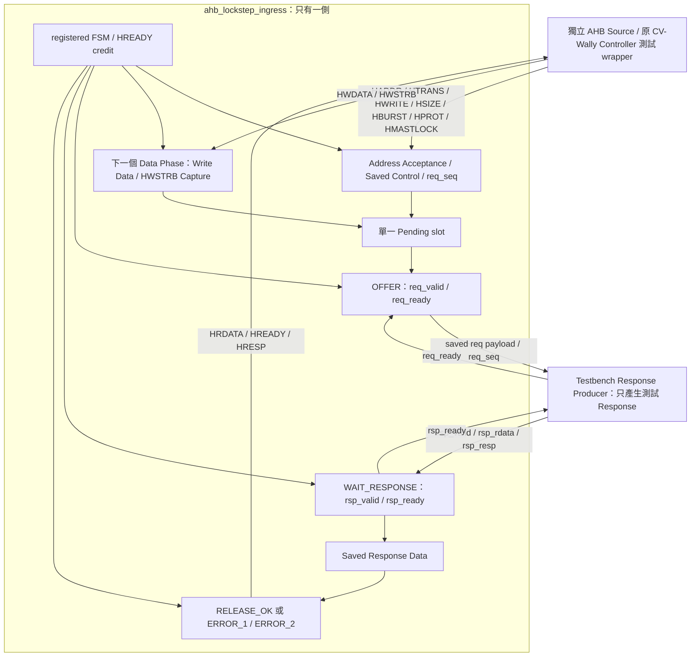

# Step 3B Meeting Report：Single-Side AHB Ingress Adapter

## 1. 成果狀態與 Git

**已實作並通過本報告所列測試**：單側 AHB Ingress、單一 Pending slot、Write Data Capture、內部 Request/Response handshake、Response Release、兩周期 Error Response、Reset Cancellation，以及既有 CV-Wally Controller 的相容性測試。

**未實作**：Core B、Comparator、Output Gate、Pair Alignment、完整 Dual-Core Lockstep、Uncore AHB master。新模組尚未實例化到 SoC。

- Branch：`ahb-lockstep-step3`，由 Step 2 Checkpoint 建立。
- HEAD/Baseline：`8ff5bf2471d51e45a3317768e04aac4bb97d3ee0`，沒有新增 Commit 或 Push。
- Step 1 Baseline：`aebe53d12a1003791bd8f3d8823635aaa3d0330e`，保留。
- Step 3A：`docs/ahb-dual-core-step3-design.md`，原樣保留、沒有覆寫。
- 主要測試結果：`artifacts/ahb-lockstep-step3b/run-002/summary.json`。
- `run-001/` 保存初次手動測試及 Warning Log；`run-002/` 是使用新重跑 Script 完整執行的乾淨成功結果。
- 修改前 394 個既有 RTL／報告／備份／Waveform／Log 的 SHA-256 全部未變；run-002 另保護當時已完成的新 Ingress RTL，共核對 395 個檔案。

## 2. 簡單概念與實際 RTL 依據

Ingress 可以理解成一個「先收好一筆 Address，等資料與 Response 都準備好再完成」的入口。它不是把每個 HREADY=0 cycle 都當成新的 Request，也不是外部 Memory Controller。

原有 CV-Wally 的 `src/ebu/busfsm.sv:86–87` 在初始 Address Phase 用 HREADY 產生 HTRANS。如果 Ingress 在空閒時就一直回 HREADY=0，原 Controller 可能根本不產生 Request。

因此新模組在 Reset 解除且 EMPTY 時直接提供 HREADY=1，這個結果不依賴 HTRANS、req_ready 或 rsp_valid。接受 Address 後才 Stall。

原 `src/ebu/ahbinterface.sv:61–63` 將 Write Data/Strobe 延遲一拍；Cache 版本 `src/ebu/ahbcacheinterface.sv:112–122` 也以 HREADY 啟用資料暫存。新 Ingress 因此在接受 Write Address 的下一個 Data Phase 擷取 HWDATA/HWSTRB，不能在 Address acceptance edge 就取同拍資料，也不能用新的 HWRITE 遮罩它。

原 EBU 的輸出及 IFU/LSU Arbitration 位於 `src/ebu/ebu.sv:100–128`。本次沒有改動，也沒有接真實 Core；相容性測試直接使用原 AHB Controller modules。

## 3. 完整 Block Diagram



此處的 req/rsp ready/valid 是未來 Guard 內部或目前 Testbench 的介面，**沒有修改原有 Core-facing AHB 介面**。沒有下游 Uncore H* master，也沒有 Match、Allow 或 Output Gate 邏輯。

## 4. RTL Input / Output

新增 `src/ebu/ahb_lockstep_ingress.sv`，參數預設：ADDR_WIDTH=56、DATA_WIDTH=64、STRB_WIDTH=DATA_WIDTH/8、SEQ_WIDTH=32。未來 SoC 應明確傳入 P.PA_BITS、P.AHBW、P.XLEN/8，不能假設所有配置的 byte strobe 都可從 DATA_WIDTH 推導。

### AHB-facing ports

| 方向 | 訊號 | 寬度／用途 |
|---|---|---|
| Input | HCLK、HRESETn | 共同 Clock／active-low Reset |
| Input | HADDR | ADDR_WIDTH |
| Input | HTRANS | 2，NONSEQ/SEQ 為有效 Address |
| Input | HWRITE | 1 |
| Input | HSIZE、HBURST | 各 3 |
| Input | HPROT | 4 |
| Input | HMASTLOCK | 1，原樣保存，不做 policy 判斷 |
| Input | HWDATA | DATA_WIDTH，Data Phase 資料 |
| Input | HWSTRB | STRB_WIDTH，Data Phase strobe |
| Output | HRDATA | DATA_WIDTH，保存的 Response Data |
| Output | HREADY | 1，空間或 Data Phase completion |
| Output | HRESP | 1，兩周期 Error Response |

### Guard-internal／Testbench ports

| 方向 | 訊號 | 語義 |
|---|---|---|
| Output | pending_valid | 有一筆已接受但未完成的 AHB Data Phase；不代表 Request payload 已完整 |
| Output | req_valid | saved Request 已完整且尚未 dispatch |
| Input | req_ready | 測試回應端／未來 Guard 願意接受此 saved Request |
| Output | req_seq | SEQ_WIDTH，每次有效 Address acceptance 增加的 local ordinal |
| Output | req_addr、req_write | 保存的 Address／方向 |
| Output | req_size、req_burst、req_prot、req_trans、req_lock | 保存的 Control，寬度對應原 AHB |
| Output | req_wdata、req_wstrb | 對應該已接受 Write Address 的保存資料；Read 時清為 0 |
| Input | rsp_valid | 測試端有一筆 Response |
| Output | rsp_ready | Ingress 正在等待其已 dispatch Request 的 Response |
| Input | rsp_rdata、rsp_resp | Response payload |

內部協定：

- `req_valid && req_ready` 的上升緣表示 dispatch 一次。即使後端長期保持 req_ready=1，Ingress 也只會 dispatch 一次。
- `rsp_valid && rsp_ready` 的上升緣保存 Response；rsp_valid 須遵守 ready/valid，不能只在 rsp_ready=0 時脈衝一下就消失。
- 最早在 Request dispatch 後的下一個 cycle 才接受 Response；不支援同一個 edge 同時 dispatch 與接受其 Response。
- 一次只有一個未完成 Request；後端必須依序、每次 dispatch 恰好回一筆 Response，不能重複回。
- Reset 必須同時 flush 後端；本版 Response 沒有 seq/epoch tag，不能辨認新 Pending 期間才到達的舊 Response。

## 5. FSM、Register 與重要 RTL

### FSM

| State（Waveform 值） | HREADY | req_valid | rsp_ready | 動作 |
|---|---:|---:|---:|---|
| EMPTY（0） | 1 | 0 | 0 | 等有效 Address，IDLE/BUSY 不建立 token |
| CAPTURE_DATA（1） | 0 | 0 | 0 | 擷取前筆已接受 Write 的 Data/Strobe，一次後離開 |
| OFFER（2） | 0 | 1 | 0 | 保存 Request，等 req_ready handshake |
| WAIT_RESPONSE（3） | 0 | 0 | 1 | 等一筆 Response，保存後進 Release/Error |
| RELEASE_OK（4） | 1 | 0 | 0 | 舊 Data Phase 完成，可同緣接受下一筆 Address |
| ERROR_1（5） | 0 | 0 | 0 | HRESP=1 的第一周期，不接受新 Address |
| ERROR_2（6） | 1 | 0 | 0 | HRESP=1 的第二周期，完成舊 Data，可同緣接受新 Address |

HRESETn=0 時 HREADY/HRESP/req_valid/rsp_ready/pending_valid 均為 0；Reset 解除後 EMPTY 立即提供 credit。

State transition：

```text
EMPTY --Read Address accepted--> OFFER --request handshake--> WAIT_RESPONSE
EMPTY --Write Address accepted--> CAPTURE_DATA --> OFFER --> WAIT_RESPONSE
WAIT_RESPONSE --OK Response captured--> RELEASE_OK
WAIT_RESPONSE --Error Response captured--> ERROR_1 --> ERROR_2
RELEASE_OK / ERROR_2 --next Read accepted--> OFFER
RELEASE_OK / ERROR_2 --next Write accepted--> CAPTURE_DATA
RELEASE_OK / ERROR_2 --IDLE/BUSY--> EMPTY
任意 State --Reset--> EMPTY，取消 Pending
```

Step 3A 概念中的 ADDR_ACCEPTED 直接在 acceptance edge 完成保存，Read 不額外設一個空的 ADDR_ACCEPTED state；本版新增明確 OFFER／req_ready handshake，避免 consumer 將多周期 Pending 當成重複 Request。這是介面細化，不是新增 Pair Alignment。

### Register

- `state`：registered phase／credit 控制，不由 live HTRANS 形成組合回授。
- `req_*`：Address/Control/Data/Strobe 與目前 local sequence。
- `next_seq`：僅有效 Address acceptance 時增加；Reset 清零，沒有 epoch。
- `rsp_data_q`：獨立 Response Register，不與 Request slot 共用；下一筆 Address 同緣覆寫 req_* 不會破壞舊 Response。
- HRESP 由 ERROR_1/ERROR_2 State 編碼，不需要另一個重複的 error Register。

### 關鍵位置

- `ahb_lockstep_ingress.sv:12–39`：完整介面。
- `:41–54`：FSM 與 HREADY/HRESP/valid/ready 輸出。
- `:56–70`：Reset 清除 Pending、sequence、Request／Response 資料。
- `:73–89`：EMPTY、RELEASE_OK、ERROR_2 共用 Address capture；避免 Release edge 丟下一筆。
- `:91–96`：Write Data/Strobe 下一拍擷取；不用當前 HWRITE/HTRANS 遮罩。
- `:98–105`：Request dispatch 與 Response capture 分離，沒有 repeated dispatch。
- `:107`：Error 第一周期轉到第二周期。

`HTRANS[1]` 只在上述 ready States 被檢查；其他 States 即使 HTRANS 持續有效也不接受新 Address。保持同樣地址不會被用來去重，兩次相同地址但不同 handshake 仍是兩個 token。

## 6. 測試方法：逐 Cycle，不只看數量

`tests/ahb_lockstep/ingress_tb.sv` 使用獨立的 phase ledger，並沒有讀 DUT.state 來複製其 FSM。

每個 cycle：

1. 在負緣驅動 synthetic AHB 與內部後端訊號。
2. 負緣後 1 ps 檢查所有公開 handshake、保存的 metadata/data/sequence 與 HRDATA。
3. 正緣前再檢查並記錄 acceptance、dispatch、response capture、completion。
4. ledger 先完成舊 Data Phase，再記錄可能同緣出現的新 Address。
5. 正緣後 1 ps 再核對 DUT 輸出，捕捉錯一拍的問題。

因此不只是確認最後 counts 相同；包括 HREADY 拉高的精確 cycle、Error 第一／第二周期、saved payload 是否被 live Address/Data 改寫，都逐 cycle 檢查。

`unit/ingress-cycles.csv` 保存 46 個正緣的前置取樣值；137 次檢查包括 edge 前、edge 後與負緣後檢查。

### 測試覆蓋與結果

| 項目 | 已驗證情境 | 結果 |
|---|---|---|
| Initial Request／Deadlock Prevention | synthetic HTRANS 依 HREADY 才出現；原 busfsm 也實際測試 | PASS |
| SINGLE Read | 接受、後端等待、保存 Response、正確 completion | PASS |
| SINGLE Write | Address 時 sentinel 資料無效，下一拍抓正確 Data/Strobe | PASS |
| Multi-cycle Stall | OFFER 等 req_ready、WAIT_RESPONSE 等 rsp_valid | PASS |
| Back-to-back／Overlap | 舊 Write completion 同緣接受下一 Write／Read | PASS |
| Release + Next Address | 205/245/275/315 ps 同緣完成與接受 | PASS |
| IDLE/BUSY | 不建立 Request；BUSY 可與舊 Data completion 重疊 | PASS |
| NONSEQ/SEQ | 保留 metadata；原 cache FSM 的真實 8-beat sequence | PASS |
| Reset with Pending | CAPTURE_DATA 與已 dispatch 的 WAIT_RESPONSE 各取消一筆 | PASS |
| Error Propagation | saved error data、ERROR_1 ready=0、ERROR_2 ready=1、下一 Address capture | PASS |
| Stray Response | EMPTY 不提供 rsp_ready，不能完成不存在的 Request | PASS |
| Payload Stability | 內部 backpressure 與等待 Response 期間保持保存內容 | PASS |

主測試結果：

```text
INGRESS_TEST_PASS cycles=46 checks=137
accepted=9 dispatched=8 responses=7 completed=7 reset_cancelled=2 wait_cycles=26
```

9 個 accepted 中，7 個完成、2 個由 Reset 取消；其中一個 Write 在 dispatch 前取消，另一個 Read 在 dispatch 後取消，所以 dispatch=8、Response=7。不是漏掉兩筆 Transaction。

### 原 CV-Wally Controller 相容性

`ingress_cvw_tb.sv` 的 CACHE_MODE=0 直接實例化未修改的 ahbinterface／busfsm，包含 Write Data flop 與 Read FetchBuffer。後端固定延遲三個 cycles，再回 Response；測試完成 Read/Write 各一次，並確認 FetchBuffer 取得保存的 Read Response。

```text
CVW_INGRESS_TEST_PASS mode=0 accepted=2 dispatched=2 completed=2 cache_ack=0
```

CACHE_MODE=1 直接實例化未修改的 buscachefsm 與其 BeatCount Registers；測一條 INCR8 Read，確認每個 saved Address、NONSEQ/SEQ、HBURST、seq，8 次接受／dispatch／completion 與唯一 CacheBusAck：

```text
CVW_INGRESS_TEST_PASS mode=1 accepted=8 dispatched=8 completed=8 cache_ack=1
```

這是 Controller-level wrapper，不是真實 Core、不是完整 Cache/EBU/Uncore integration，也沒有新增 Burst Output Gate。Ingress 只保存每筆的 Burst metadata，不驗證整個 Burst 的合法性或生成下游 BUSY。

另以 ADDR_WIDTH=32、DATA_WIDTH=32、STRB_WIDTH=4、SEQ_WIDTH=8 做 RTL lint/elaboration，通過、無 Warning；此項是 lint，不宣稱 32-bit runtime 測試。

## 7. 實測 SINGLE Read／Write Cycle-by-Cycle

RUN 代表 `artifacts/ahb-lockstep-step3b/run-002`。時間為 VCD 原始 **1 ps** timescale。下列 edge table 都是上升緣之前的值；GTKWave 在相同時間點通常顯示 NBA 更新後的值，閱讀 acceptance 請看 edge 左側。

### SINGLE Read：HADDR=0x100

| 上升緣 | 緣前 State／HREADY | 事件 |
|---:|---|---|
| 25 ps | EMPTY／1 | NONSEQ Read Address 被接受，保存 req_addr=0x100、seq=0 |
| 35 ps | OFFER／0 | req_valid=1、req_ready=0，保持 token |
| 45 ps | OFFER／0 | 同上，不重新接受 AHB Request |
| 55 ps | OFFER／0 | 同上 |
| 65 ps | OFFER／0 | req_ready=1，dispatch 一次 |
| 75 ps | WAIT_RESPONSE／0 | rsp_ready=1，Response 尚未到 |
| 85 ps | WAIT_RESPONSE／0 | 繼續等待 |
| 95 ps | WAIT_RESPONSE／0 | 繼續等待 |
| 105 ps | WAIT_RESPONSE／0 | rsp_valid=1、rsp_rdata=0x1111，保存 Response |
| 115 ps | RELEASE_OK／1 | HRDATA=0x1111，Read Data Phase 正式完成 |

HREADY 在 [25,105) ps 為 0；[105,115) ps 是完成前的 Release cycle。Data Phase 從 Address acceptance 後延長到 115 ps，不能把 105 ps 的內部 Response capture 誤認為 AHB completion。

### SINGLE Write：HADDR=0x200

| 上升緣 | 緣前 State／HREADY | 事件 |
|---:|---|---|
| 145 ps | EMPTY／1 | 接受 Write Address，這拍的 Write Data sentinel 不使用 |
| 155 ps | CAPTURE_DATA／0 | 擷取 0xdeadbeefcafef00d、HWSTRB=0x81；當前 HWRITE=0、HTRANS=IDLE |
| 165 ps | OFFER／0 | req_ready=0；保存的 Write Data 不受後續 live Data 雜訊影響 |
| 175 ps | OFFER／0 | 繼續保持 |
| 185 ps | OFFER／0 | dispatch saved Write 一次 |
| 195 ps | WAIT_RESPONSE／0 | 保存正常 Response |
| 205 ps | RELEASE_OK／1 | 完成 0x200，且同緣接受下一筆 Write Address 0x300 |
| 215 ps | CAPTURE_DATA／0 | 擷取 0x300 的資料 0x3333、Strobe=0x0f；Bus 已呈現下一個 Read Address 0x308 |

205 ps 舊 Request 的 Response 與新 Address 是兩個不同 phase；rsp_data_q 和 req_* 分開保存，因此沒有被新 Address 覆蓋。

下一筆 Write 在 245 ps 完成，同緣接受 0x308 Read；0x308 在 275 ps 完成，同緣接受另一個 SEQ metadata 測試 Request。

### Error Response

對 req_addr=0x310：

| 時間／edge | HREADY／HRESP | 行為 |
|---|---|---|
| 295 ps edge 前 | 0／0 | 接受 rsp_valid=1、rsp_resp=1、rsp_rdata=0x5555 |
| [295,305) ps | 0／1 | ERROR_1；不能接受下一 Address |
| 305 ps edge | 0／1 | 只進入 ERROR_2，不接受已出現的 0x400 |
| [305,315) ps | 1／1 | ERROR_2，保持相同 HRDATA |
| 315 ps edge | 1／1 | 完成 error Data Phase，同緣接受 0x400 |
| 315 ps 更新後 | 0／0 | 新 Request 進 OFFER，不會沿用前筆 HRESP |

Error 只是介面傳遞；原 EBU 目前沒有使用 HRESP，不能把測試結果解讀成 CPU trap/recovery 已完成。

### Reset Cancellation

- Write 0x500 在 355 ps 接受；HRESETn 於 357 ps 拉低，立即取消 CAPTURE_DATA 的 Pending。
- Read 0x600 在 385 ps 接受、395 ps dispatch；397 ps 拉低 Reset，取消 WAIT_RESPONSE。
- CSV ledger 在下一個正緣 365/405 ps 記錄這兩次 cancellation；不是說 async Reset 等到該緣才生效。
- 425 ps 的新 Read 0x700 重新從 seq=0 開始，455 ps 完成。

## 8. Waveform／GTKWave／截圖

保留的主要檔案：

- `RUN/unit/ingress.vcd`：主 Testbench，精確最後時間戳 457 ps；Verilator console 的 finish time 顯示 460 ps 是報表取整。
- `RUN/unit/ingress-cycles.csv`：逐 Cycle 正緣前數值與四種 handshake event。
- `RUN/cvw-single/ingress-cvw.vcd`：原 ahbinterface/busfsm wrapper。
- `RUN/cvw-cache/ingress-cvw.vcd`：原 buscachefsm wrapper。
- `RUN/unit.log`、`RUN/cvw-single.log`、`RUN/cvw-cache.log`、`RUN/verification.log`。

新增 `docs/waveforms/ahb-lockstep-step3b/ingress.gtkw`，只含與 Adapter 有關的 25 條訊號，另有 read/write-overlap/error/reset 四個 Tcl 視窗。沒有覆蓋先前任何 GTKWave 設定。

從 repository root：

```bash
gtkwave artifacts/ahb-lockstep-step3b/run-002/unit/ingress.vcd   docs/waveforms/ahb-lockstep-step3b/ingress.gtkw   -S docs/waveforms/ahb-lockstep-step3b/read.tcl
```

| Tcl | 時間範圍 | 展示重點 |
|---|---|---|
| read.tcl | 10–125 ps | Initial credit、OFFER/Response Stall、正常 Release |
| write-overlap.tcl | 135–280 ps | 下一拍 Write Data Capture、205/245 ps 的 completion+acceptance |
| error.tcl | 270–330 ps | HRESP 兩周期與 ERROR_2 接受下一筆 |
| reset.tcl | 345–460 ps | Reset 取消 Capture/Wait、sequence 重啟 |

GTKWave 訊號名稱與寬度已靜態對照 VCD header；本次沒有啟動 GUI。

**截圖路徑：尚未產生。** 已提供 Waveform、精確範圍與設定，Meeting 可按上表擷取。

## 9. 測試指令與可重現性

工具：Verilator 5.036，啟用 --assert、--trace、--timing、--timescale 1ps/1ps；沒有為隱藏 Warning 加入 suppression。

本次初次測試用 run-001，之後以全新 run-002 驗證整套 runner：

```bash
python3 tests/ahb_lockstep/run_ingress.py artifacts/ahb-lockstep-step3b/run-002
```

重跑必須換新的 run-003 等目錄；Script 對已存在目錄直接拒絕，不覆蓋舊 Waveform/Log。Script 會：

1. 保存既有 source/design/artifact 雜湊。
2. Build/run ingress_tb。
3. Build/run ingress_cvw_tb，CACHE_MODE=0/1，參數使用明確 1-bit literal。
4. 解析 CSV／Log，確認 acceptance/completion/dispatch/response 的逐筆對應。
5. 驗證所有 preserved hashes，exclusive-create summary.json。

主測試的實際 Build 等價命令：

```bash
verilator --binary --trace --timing --assert --timescale 1ps/1ps   --top-module ingress_tb --Mdir <NEW_RUN>/work-unit   src/ebu/ahb_lockstep_ingress.sv tests/ahb_lockstep/ingress_tb.sv
```

各案例完整 argv 保存於 RUN/unit-command.json、RUN/cvw-single-command.json、RUN/cvw-cache-command.json。runtime 分別從各自的新目錄執行 binary，因此 VCD/CSV/Log 不寫回原 sim/verilator 目錄。

32-bit elaboration：

```bash
verilator --lint-only --timing --top-module ahb_lockstep_ingress   -GADDR_WIDTH=32 -GDATA_WIDTH=32 -GSTRB_WIDTH=4 -GSEQ_WIDTH=8   src/ebu/ahb_lockstep_ingress.sv
```

最終結果：run-002 三個 Build/runtime 與離線核對皆 PASS、沒有 Warning；32-bit lint 也無 Warning。Python Script 的 Ruff check 與 whitespace 檢查通過。

## 10. 修改檔案與保護範圍

新增 RTL：

- `src/ebu/ahb_lockstep_ingress.sv`。

新增測試／工具：

- `tests/ahb_lockstep/ingress_tb.sv`。
- `tests/ahb_lockstep/ingress_cvw_tb.sv`。
- `tests/ahb_lockstep/run_ingress.py`。
- `tests/ahb_lockstep/summarize_ingress.py`。

新增文件／展示設定：

- `docs/ahb-dual-core-step3b.md`。
- `docs/waveforms/ahb-lockstep-step3b/ingress.gtkw`。
- `docs/waveforms/ahb-lockstep-step3b/read.tcl`。
- `docs/waveforms/ahb-lockstep-step3b/write-overlap.tcl`。
- `docs/waveforms/ahb-lockstep-step3b/error.tcl`。
- `docs/waveforms/ahb-lockstep-step3b/reset.tcl`。

產物：artifacts/ahb-lockstep-step3b/run-001、run-002，保留於本機，不等於待提交的 RTL／文件。

未修改 ebu.sv、busfsm.sv、ebufsmarb.sv、Uncore、ahb_monitor.sv、ahb_shared_guard.sv、wallypipelinedsoc.sv、tests/riscof/config.ini。沒有執行 git reset --hard、clean、restore、Commit 或 Push。

Step 2 SoC 沒有實例化本模組，所以本次沒有重新跑完整 Hello Wally；原 Step 1/2 Baseline 與已驗證產物按雜湊保留，不能把它說成本次新增 RTL 的全系統整合測試。

## 11. 與 Step 3A 的對照

| Step 3A 要求 | Step 3B 實作／驗證 |
|---|---|
| 空側先提供 credit，避免 HREADY-dependent HTRANS Deadlock | EMPTY HREADY=1；synthetic source 與原 busfsm wrapper 均通過 |
| 分開 Address acceptance／Data completion | pending slot 與 Release FSM；CSV 四類事件分開 |
| 保存 Address/Control | req_* Register，wait 期間持續比對 |
| Write 下一拍 capture | CAPTURE_DATA，一次擷取，current HWRITE=0 仍正確 |
| Release 同緣接受下一筆 | EMPTY/RELEASE_OK/ERROR_2 共用 Address capture；205/245/275/315 ps 驗證 |
| 保存 Response 避免 live HRDATA 改變 | rsp_data_q；Response producer 改資料不會破壞已保存結果 |
| local_seq 與 Reset | acceptance ordinal、Reset 歸零；尚無 epoch/tagged response |
| 原 Controller wrapper 相容性 | ahbinterface/busfsm 與 buscachefsm，無真實 Core |
| Pair Alignment／Comparator／Gate／雙側 Response | 本次沒有實作，留 Step 3C 之後 |

OFFER/req_ready 是本次明確化的內部 dispatch handshake，目的在防止 future consumer 將持續有效的 Pending 重複處理；沒有新增另一套 Core-facing protocol。

## 12. 問題、尚未完成功能與風險

已修正並保留紀錄：

- run-001 的 Controller wrapper 首次 Build 有兩個 32→56-bit address literal Warning，已在新 Testbench 明確使用 56-bit literal。
- CACHE_MODE=1 的 command-line override 首次為 32-bit literal，導致 1-bit parameter Warning；改用明確 `1'b1`，沒有修改原 Controller。
- Warning 時 Verilator 未產生 cache binary；初次啟動嘗試的失敗 Log 也保留。run-002 的 runner 會在 Build 非零時停止，不會繼續執行不存在的 binary。

尚未完成／風險：

1. 沒有 Core B、Pair Alignment、Comparator、Output Gate、Uncore master 或 Dual-Core Response Distribution。
2. Response 是單一 outstanding、in-order 的未加 tag 介面。Reset 要同時 flush consumer/producer；若舊 Response 在新的 WAIT_RESPONSE 才到，本版無法區分。後續需 epoch/tag 或明確全路徑 flush contract。
3. req_seq 會 wrap、Reset 歸零；不是跨 Reset 的唯一 transaction ID。
4. 沒有 timeout/fault isolation／對非 Reset Flush 的取消 sideband；後端永久不回 Response 會持續 Stall，這是服務前提不足，不是本版自動恢復能力。
5. Error Propagation 不等於 CPU Error Handling。原 EBU 忽略 HRESP；本模組不對 Error 自動 HALT 或重新嘗試。
6. 保存 NONSEQ/SEQ/HBURST 不等於完整 Burst protocol checker；wrapping、Atomic、boundary、Mismatch 等仍需後續 Guard 設計。
7. 沒有完整 IFU/LSU Arbitration＋Core/Cache/Uncore 整合；相容性 wrapper 不能取代 real-core regression。
8. runtime 驗證為 Verilator 二態模擬；四態 X/Z、Synthesis/STA、Formal liveness 尚未做。32-bit 只有 lint。
9. 一次一個 Pending 的設計會增加 latency；不宣稱 Step 2 逐周期透明性，也不保證每拍接受新 Address。
10. Passive Monitor 沒有參與功能或測試回應產生，未修改；將來仍只供 Debug/Verification。

## 13. 下一步

等待使用者審查本 Step 的 RTL、逐 Cycle CSV 與 Waveform，再決定 Git Checkpoint。沒有自動 Commit。

確認後才進入 Step 3C：使用兩個本 Ingress 與 synthetic agents 驗證 Request Alignment／Response Distribution，先不接真實 Side Effect。Core B、Comparator、Output Gate 仍須分階段實作，不與本次混在一起。
