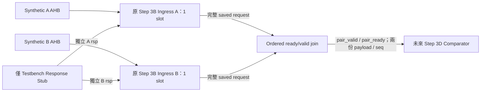

# Step 3C：Dual Ingress + Request Alignment

## 結果與範圍

**實作與測試 PASS**。目前 Branch `ahb-lockstep-step3`、HEAD `782dbddeee15fdbcd19f898a21302f9edddb5dc9`。本次未 Commit／Push。新模組尚未接入 SoC，沒有第二顆 CV-Wally Core、Shared Uncore master、Comparator、Output Gate 或功能性 Response Distribution。

最新使用者指定的分期優先於 Step 3A 文件的概念規劃：本階段只處理 Dual Ingress／Request Alignment；Comparator 留 Step 3D，真正 Response Distribution 留 Step 3E。舊設計文件與 Step 3B／Performance Baseline 報告不改寫，作為歷史證據。

測試證據：`artifacts/ahb-lockstep-step3c/run-002/summary.json`。125 rising edges、244 次 counter checks、18 次 pair handoff。A/B 各 accepted20、completed17、reset_cancelled3，無剩餘 pending。Build／32-bit lint／Step 3B 原測試 regression 均 PASS，零 Warning。

## 實際 Step 3B 能力核對

原 `ahb_lockstep_ingress.sv` 完全保留：

- 每側一個 pending slot，非多深 FIFO。EMPTY、RELEASE_OK、ERROR_2 提供 HREADY；不依 HTRANS 或 peer 產生初始 credit。
- Read Address 接受後進 OFFER；Write 先進 CAPTURE_DATA，於下一個 rising edge 捕捉前筆 Write Data/Strobe，再進 OFFER。
- req_valid 只表示 OFFER 的完整 saved request；pending_valid 還包括尚未完成 data capture／已 dispatch 等階段，不能替代 req_valid。
- req_valid && req_ready 消耗一次後進 WAIT_RESPONSE；最早下一個 edge 接受 Response，不能同緣 dispatch/response。
- rsp_valid && rsp_ready 保存回應後，經 RELEASE_OK 或 ERROR_1/ERROR_2 完成 upstream data phase。Release edge 可接受下一個地址。
- local req_seq 每次有效 Address acceptance 增加，會 wrap、reset 歸零；沒有 epoch 或 response tag。Common reset 必須 flush 外部 producer。

新架構直接使用這些能力，不需要修改原 FSM 或 slot 深度。

## Architecture



`ahb_lockstep_dual_ingress` 實例化兩個原 Step 3B ingress 和一個 `ahb_lockstep_pair`。Pair 本身沒有額外 payload buffer；資料一直保存在各 ingress。這是兩個一筆 slot 的 join，不是兩個 request arbiter，也不搜尋 matching address。

## Paired request handoff

| Port | 語意 |
|---|---|
| pair_valid | reset 解除且 A_req_valid && B_req_valid；只代表有兩份完整 request，並非 match／allow |
| pair_ready | consumer 有儲存／接受能力；不是比較成功或准許 issue |
| pair_valid && pair_ready | 同一 rising edge 原子消耗兩側 OFFER，兩個 ingress 一起進 WAIT_RESPONSE |
| pair_seq | 本 reset interval 的 handoff ordinal，SEQ_WIDTH 位，handshake 才加一 |
| pair_a_seq / pair_b_seq | 各側原 Address acceptance ordinal，原樣交給 consumer |
| pair_a_* / pair_b_* | 各自 addr、write、size、burst、prot、trans、lock、wdata、wstrb |
| paired_requests | 64-bit handoff count，每次 pair handshake 加一；reset 清零 |

內部公式：`a_req_ready = HRESETn && pair_ready && b_req_valid`；B 對稱。單側先到時，它不會 dispatch，另一側 EMPTY 仍有 HREADY credit。兩側同時有效且 consumer ready，下一個 rising edge handoff。Consumer backpressure 時兩份 saved payload／seq 保持，沒有半個 pair 被獨自消耗。

消耗後兩個 req_valid 下降，避免 pair_ready 常高造成重複。各 ingress slot 直到自己的 response/release 才釋放，因此最多一筆 dispatch 待回應。即使測試讓 A 先完成並接受 n+1，而 B 還在等 n 的 Response，B 的 req_valid=0，不會將 A(n+1) 配到 B(n)。只等 B 也接受下一筆，才形成下一個 pair。

維持原始 ordinal stream，連續相同地址仍形成不同 token。Pair RTL 不比較任何 payload 或 local_seq，也不跳過不相同 head；所有一致性／policy 判斷由 Step 3D 負責。測試故意送不同 write/data/control，以及一次不同地址的 pair，確認本階段沒有暗中增加 payload gate。

沒有 downstream HADDR／HTRANS 或 Uncore port，故任何未比較 request 都沒有對 Shared Uncore 發出存取的路徑。測試回應只是讓 Synthetic A/B 向前進，不是 match 或實際 Memory 結果。

## Pairing Wait Counter 定義

所有事件取 rising edge 前值，HRESETn=1 時：

| Counter | 每 edge 的增加條件 |
|---|---|
| pairing_wait_cycles | A_req_valid XOR B_req_valid |
| a_peer_wait_cycles | A_req_valid && !B_req_valid |
| b_peer_wait_cycles | B_req_valid && !A_req_valid |
| pair_backpressure_cycles | pair_valid && !pair_ready |
| paired_requests | pair_valid && pair_ready |

開始：一側完整 OFFER 已可見的第一個 sampling edge。停止：兩側 OFFER 均可見的第一個 edge，即使 pair_ready=0 也停止 peer wait。若晚側 Address／Write Data 在該 edge 的 NBA 後才令 req_valid 升高，該 edge 仍屬單側等待。EMPTY／雙方等待 Response 不計數。單側 n+1 等另一側完成 n 並形成 n+1 OFFER，也符合 XOR 而計數。

Write data capture 尚未完整時不算該側可用，故同時抵達的兩筆 Read 或兩筆 Write 不會產生 peer wait；若一筆 Read、一筆 Write，後者需要一拍 data capture，會有一拍 availability skew。這是完整 request readiness 的差異，不是 payload mismatch。

Counters 由共同 active-low reset 非同步清零，不設定 timeout、不觸發 fault 或放行；64-bit unsigned modulo overflow。pair_seq/local_seq modulo SEQ_WIDTH。這些是 Step 3C reset-interval counters，不改動 `reset_release_to_tb_complete_v1` 或既有 Performance Monitor 計數語意。

## Step 3D / Step 3E 責任界面

Step 3D：握手時保存兩份 payload 和 pair identity；比較 address/control、對 Write 比較 data/strobe。未 match 前不得發出 downstream有效 Address，包括有 read side effect 的 Read。Comparator 的儲存 credit 才驅動 pair_ready，不應將 live match 當 ready 造成相依。Mismatch 的 fault/收尾留後續設計，Step 3C 不自行回成功。

目前 wrapper 暴露 A_rsp_valid/ready/rdata/resp 及 B 對稱介面，原樣接入各 ingress；沒有 rsp fork、額外 response FSM 或共用 response buffer。

Step 3E：在 pair handoff 與唯一 downstream completion 間保存 pair/tag 關係，保存單份 read/error response，再向正確的兩個 ingress 各交付恰好一次；須實作兩側 consumed tracking／同時 release policy及 backpressure handling。不能把持續的共用 rsp_valid 無條件廣播，讓先接收側重複消耗。Normal/error 回應仍需遵守原 ingress 下一拍起可接受 response 及兩周期 AHB error release。

當前無 epoch/tag，reset 必須共同 flush ingress、join、Comparator 和 response producer；若 producer 把舊 Response 拖到新 WAIT_RESPONSE，本版無法辨認。這是延續 Step 3B 的明確 integration contract，不宣稱支援任意 stale response recovery。真正系統若無法保證 flush，須在後續先設計 tag/epoch。

## 測試方法與實測

`alignment_tb.sv` 在 negedge 驅動訊號，正緣 pre-NBA 建立 acceptance／pair／response／completion ledger，正緣後1ps核對 counter，task 在後續 negedge 檢查 settled 狀態。不讀 DUT.state 來決定 oracle。

Ledger 保存每側 acceptance metadata 和下一拍 Write Data；逐欄核對公開 paired payload。對每個 pair 檢查兩側有 pending、各未 dispatch、ordinal 正確；記錄 unique dispatch。Completion 必須已有該 token 的 response，且優先處理舊 Data 再接受新 Address。Reset 取消已接受未完成 token。Backpressure 每拍檢查 payload/seq 穩定。

SEQ_WIDTH=3 的 runtime 故意讓 ordinal 跨8 wrap；重複地址仍逐筆前進。另以 ADDR_WIDTH32/DATA_WIDTH32/STRB_WIDTH4/SEQ_WIDTH8 lint，非32-bit runtime 宣稱。

| Directed case | 預期 peer wait | 實測 peer wait | 實測 consumer backpressure |
|---|---:|---:|---:|
| Simultaneous Read | 0 | 0 | 0 |
| A early 1 | 1 | 1 | 0 |
| A early 4 | 4 | 4 | 0 |
| B early 3 | 3 | 3 | 0 |
| Simultaneous Write | 0 | 0 | 0 |
| A early Write 2 | 2 | 2 | 0 |
| B early Write 2 | 2 | 2 | 0 |
| Both-valid backpressure | 0 | 0 | 5 |
| A early 3 + backpressure | 3 | 3 | 4 |
| Read/Write readiness skew（不同 payload） | 1 | 1 | 2 |
| 重複相同地址，4次 | 各0 | 各0 | 各0 |
| Reset後新 seq0 | 0 | 0 | 0 |

另測 asymmetric response + release/next address overlap，peer wait4 cycles；reset A等待時3 cycles後取消；reset B CAPTURE_DATA；reset both-valid backpressure；reset post-dispatch；EMPTY stray responses和 IDLE/BUSY 不建立 token。

18 paired requests 中17對各完成一次，1對在 dispatch 後 reset 取消。每側還各有2筆 dispatch前 reset取消，因此 accepted20=completed17+cancelled3；dispatched18=completed17+postdispatch_cancelled1。沒有 final pending。Counters會 reset，不能把最後 epoch 的 peer_wait0誤認為全測試等待皆0；每案例差值、完整 pre-edge CSV 及 summary 保存各 epoch證據。

Step 3B 原 regression：unit accepted9/dispatched8/responses7/completed7/cancelled2；single wrapper accepted2/completed2；cache wrapper accepted8/completed8/cache_ack1。三個原 build/runtime 與 summarizer PASS，原測試檔案未修改。

## 實際命令、工具與結果路徑

工具 Verilator `5.036 2025-04-27 rev v5.036`，clock高/低各5ps，`--timing --assert --trace --timescale 1ps/1ps`。沒有 warning suppression。

```bash
# 首次 HDL build通過，但 ccache sandbox write失敗：run-001/alignment-build.log
verilator --binary --trace --timing --assert --timescale 1ps/1ps --top-module alignment_tb --Mdir artifacts/ahb-lockstep-step3c/run-001/work-alignment src/ebu/ahb_lockstep_ingress.sv src/ebu/ahb_lockstep_pair.sv src/ebu/ahb_lockstep_dual_ingress.sv tests/ahb_lockstep/alignment_tb.sv
# 相同命令核准升權後成功：run-001/alignment-build-escalated.log

# 新目錄執行完整、最終版本：
python3 tests/ahb_lockstep/run_alignment.py artifacts/ahb-lockstep-step3c/run-002
python3 -m py_compile tests/ahb_lockstep/run_alignment.py tests/ahb_lockstep/summarize_alignment.py
git diff --check
```

Runner exclusive-create 新執行目錄，依序 build/run alignment_tb、32-bit lint、執行原 run_ingress.py於新 nested目錄，最後以 Python獨立重播CSV與驗證source hashes。完整每個命令的argv/cwd/exitcode保存 `*-command.json`／`*-result.json`。Build需 ccache sandbox外寫入，runner在權限核准後執行。

RUN=`artifacts/ahb-lockstep-step3c/run-002`：

- alignment-build.log、alignment-simulation.log、lint-32.log、verification.log、summary.json。
- unit/alignment.vcd、alignment-cycles.csv、pairing-cases.csv。
- step3b-regression/summary.json、unit.log、cvw-single.log、cvw-cache.log與各 VCD/build logs。
- source-snapshot/、source-sha256.json、toolchain.json、waveform-windows.json、preservation證據及最終git-status/diff。

新 GTKWave設定：`docs/waveforms/ahb-lockstep-step3c/alignment.gtkw`，所有訊號名稱/寬度已核對實際 VCD header；未啟動 GUI，未產生截圖。

| Waveform範圍（ps，pre-edge） | 內容 |
|---|---|
| 125–195 | A early4，175ps handoff |
| 205–265 | B early3，245ps handoff |
| 275–315 | simultaneous Write，295ps handoff，peer wait0 |
| 465–545 | both-valid backpressure5，525ps handoff |
| 665–725 | Read/Write readiness差1，705ps handoff |
| 895–995 | A先回應／接受n+1，905/975ps兩次handoff，不跨交易配對 |
| 1005–1175 | 各種 reset cancellation；完整窗口在waveform-windows.json |

## Problems & Solutions、保護與限制

- 實際 Step 3B 是單slot＋OFFER/WAIT_RESPONSE，不是概念圖中的任意深度FIFO。採不加slot的原子join，避免增加新buffer/epoch架構或修改Ingress。
- Read與Write的完整request可用時間不同。等待定義以req_valid計算並獨立測試，沒有拿pending_valid替代。
- async reset會先於下個edge清RTL counters；reference ledger於reset edge同步flush，故只在reset解除時作pre-edge比較，reset edge後核對全零。此為首次simulation前靜態校閱修正，無修改功能RTL或等待語意。
- 首次build的ccache唯讀限制以核准升權解決，原log保留；未用RTL修改或warning suppression迴避。
- 既有6946個source／tests／docs／backup／evidence檔案hash先核對全數未變，再只對meeting log追加本次記錄。歷史work-* build cache未重新寫入且不納入hash清單。其餘原Step1～3B及Performance證據保留。

本次新增兩個RTL、alignment_tb、runner/summarizer、新技術文件與GTKWave設定；只修改既有meeting log（追加）。原CPU／EBU／Shared Guard、Step3B ingress／測試、Performance Monitor／ROI及tests/riscof/config.ini不改動。沒有 commit/push。

範圍限制：沒有真正Comparator/Gate、Uncore transaction、B Response Distribution、timeout/fault policy、完整Burst master或兩顆Core。Join只保留HBURST/HTRANS metadata，不宣稱Burst合法性。Verilator二態模擬及32-bit lint不是四態／Formal／STA證明。Peer永遠不到或consumer永不ready會持續等待；不會靠timeout放行。Step2 Hello0% overhead維持原baseline結論，不代表新增Step3C主動buffering也是0%。

Meeting摘要：兩個已驗證ingress可在不同到達時間形成有序、不可半消耗的pair；peer wait與consumer backpressure有獨立計數和實測；原Step3B regression無退步。下一步Step3D先做saved-payload Comparator與compare-before-issue Gate，Step3E再處理tagged/flush-safe共用Response分送；本階段無未解決測試錯誤。
