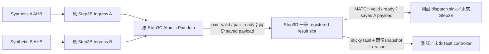

# Step 3D — Saved-Payload Comparator

## 結果與範圍

**PASS**。Branch `ahb-lockstep-step3`，起點與最終 HEAD `55ed74182345d855fc02c284d0a9ec794e7de91a`。本次沒有 commit/push。只新增 comparator／測試／文件，既有 Step3B/C、CPU、Shared Uncore、Step2 Guard、Performance Monitor／ROI不改動。新模組沒有實例化到真實 SoC。

三組 payload width runtime 共482個 directed cases：21 MATCH、461 fault；每個 fault 的正常 dispatch 都是0。另有3個 authorized-but-undelivered MATCH 被reset取消。原Step3C接線的synthetic integration：8 pair handoffs、7 normal dispatches／兩側各7 completions，1個fault由reset取消、無假response。Step3B/C regression PASS，零build warnings。

主證據：`artifacts/ahb-lockstep-step3d/run-002/summary.json`。本階段只提供內部 matched-request authorization，**沒有完整 AHB Output Gate／Uncore master／Response Distribution**，這些留Step3E。

## Step0：18 Pair Handoffs 為何只有17 Completions

直接重播既有 `artifacts/ahb-lockstep-step3c/run-002/unit/alignment-cycles.csv`，配合原 `alignment_tb.sv` 的 reset_after_dispatch case及simulation log：

| Edge | 既有證據 |
|---|---|
| 1145ps | A/B 各接受一筆 Address |
| 1155ps | pair_valid && pair_ready，兩側dispatch進WAIT_RESPONSE；尚無response capture |
| 1160ps | 既有VCD的共同HRESETn下降，非同步取消pending |
| 1165ps | CSV第一個reset sampling edge，ledger記錄兩側各1筆post-handoff cancellation |
| 測試結束 | 兩側沒有pending |

另外：A於1005ps接受／1045ps reset ledger取消；B於1065ps接受／1075ps取消；兩側於1095ps接受／1125ps取消。這些都是hand-off前取消。故每側：

- accepted20 = completed17 + reset_cancelled3。
- pair handoffs18 = completed17 + post-handoff reset_cancelled1。
- reset_cancelled3 = pre-handoff2 + post-handoff1。

不是遺失或測試結束時還在pipeline的交易；handoff和upstream completion本來就是不同事件。新 `run-001/step3c-accounting.json` 記錄全部cancelled token／CSV hash；`run-002/step3c-reset-waveform.json` 記錄既有VCD reset transition。沒有重跑或修改舊證據來解釋數量。

## Architecture 與既有介面



已核對原3B的一slot、Write下一拍capture、OFFER／WAIT_RESPONSE／release/error FSM；原3C的pair_valid只代表兩個完整request，不等於match。pair_ready是儲存credit，不能寫成match，否則mismatch會永遠停在未接收狀態。

新 `ahb_lockstep_compare.sv` 有一個result slot，FSM為 EMPTY / MATCH_PENDING / FAULT。只從pair介面取得保存過的欄位，沒有live AHB input，也沒有HRDATA／HRESP input。輸入保持原3C flat named-field格式，不修改ingress payload。

### 比較欄位與條件

| 欄位 | 寬度 | 規則 |
|---|---|---|
| addr | ADDR_WIDTH | 完整 equality |
| write | 1 | 方向 equality |
| size | 3 | 完整 equality |
| burst | 3 | 完整 equality，僅metadata，不驗證burst context |
| prot | 4 | 完整 equality，不當Core ID |
| trans | 2 | 有效beat的NONSEQ／SEQ equality |
| lock | 1 | 完整 equality，不實作lock policy |
| wdata | DATA_WIDTH | **兩側皆Write**時完整 equality，包含strobe0的lane |
| wstrb | STRB_WIDTH | 兩側皆Write時完整 equality |
| local A/B seq、pair_seq | SEQ_WIDTH | 比較前置條件：Aseq=Bseq=pair_seq |

兩側皆Read時忽略wdata/wstrb；方向不一致直接fault，不拿Read的無意義write lanes作額外硬性比較。Read response data不是request欄位，不能比較兩次讀取結果；本模組根本不接HRDATA。Unit直接注入不同Read write-lane值仍MATCH，integration也改變response input垃圾值而不影響request。

共同reset下，3C handoff ordinal與各側Address ordinal同寬、同序、同reset interval，所以seq equality有相同交易語意；不是把HREADY、arrival time或CPU cycle拿來比。沒有跨reset epoch能力。配對信任原3C契約，再以seq與有效beat檢查拒絕malformed pair；不搜尋後面的matching token、不重排。

### Equations 與 reason bits

`qualification_ok = A_seq == B_seq == pair_seq && A_trans[1] && B_trans[1]`。

資格不符先產生precondition fault，不執行payload比較。資格符合後：

```text
control_equal = addr_equal && write_equal && size_equal && burst_equal
                && prot_equal && trans_equal && lock_equal
write_equal_payload = !(A_write && B_write) || (wdata_equal && wstrb_equal)
MATCH = qualification_ok && control_equal && write_equal_payload
```

fault_reason 為11-bit mask，允許同時指出多項差異：bit0 address、1 direction、2 size、3 burst、4 protection、5 transfer、6 lock、7 write data、8 write strobe、9 ordinal前提、10 valid-beat前提。完全MATCH時mask=0。不同address/data/strobe同時注入得到0x181。即使strobe全0，完整Write Data mismatch仍fault，沿用Step3A對MMIO語意的保守選擇。

Equality不等於完整protocol authorization：相同的HBURST/lock/SEQ metadata仍可能不符合未來Uncore支援政策。等值burst測試只宣稱欄位比較，不宣稱已支援INCR8／WRAP／Atomic、boundary、burst-index檢查或lock operation；Step3E仍需protocol/context檢查。

## Timing、Backpressure 與 Fault

| State | pair_ready | match_valid | fault_valid | 行為 |
|---|---:|---:|---:|---|
| EMPTY | 1 | 0 | 0 | pair_valid edge保存兩份payload、pair_seq與比較結果 |
| MATCH_PENDING | 0 | 1 | 0 | 等match_ready；handshake只交付一次，再回EMPTY |
| FAULT | 0 | 0 | 1 | sticky保存reason／A/B證據，不消耗新pair，直到共同reset |

所有valid/ready在HRESETn=0時立即為0，state、reason、payload、identity非同步清零。初始pair_ready與payload/match無關。Capture edge的NBA後才有registered結果，不存在組合allow bypass；最早下一個rising edge才可能normal dispatch。為簡化不支援同緣drain/refill，新pair不能在舊MATCH消耗edge同時覆寫slot。

MATCH backpressure期間，兩份snapshot、result_seq、mask和valid都固定；來源在handshake後改變不影響結果。Fault同樣固定，不因match_ready變高或新的良好pair而被覆寫。最後成功dispatch後，snapshot可保留舊值，但只有valid=1時才代表可交付。

Mismatch仍會在EMPTY用正常pair handshake接收，兩個原ingress進WAIT_RESPONSE；這是**Fault接收**，不是正常Dispatch或AHB completion。fault_valid是獨立sticky診斷level，不需match_ready才能呈現；不提供fault_ready清除或自動retry。match_valid始終為0，所以正常下游sink無法收到mismatch。

本階段沒有AHB side-effect路徑；測試sink只在match_valid&&match_ready計一次正常dispatch。真實Step3E必須遵守這個valid，不能僅因有snapshot就送出Address。未驗證真實MMIO副作用或實際Output Gate安全性。

Fault後ingress的既有pending仍等待、HREADY不會回成功、沒有捏造response。本版以共同reset作fail-closed收尾，不宣稱Core已收到Error或可自行恢復。這是可觀察的terminal fault停機狀態，不是match-dependent pair_ready造成的無診斷握手deadlock。未來Step3E負責controlled fault/error收尾、response buffering／identity／雙側恰好一次消耗。Reset必須flush comparator、ingress與所有producer；舊response拖到新WAIT_RESPONSE仍不在當前tag-free介面能力內。

## Directed Verification

`compare_tb.sv` 用獨立expected-mask oracle，不讀DUT.state。negedge準備stimulus，pre-edge記錄handshake，tick返回後核對settled結果。每例保存輸入／輸出完整packed snapshots，對不同欄位逐bit注入，並在capture後更改所有輸入來驗證buffer保留。Python重新解碼全寬snapshots、獨立計算mask、逐bit核對coverage並重播handshake事件。

| ADDR/DATA/STRB/SEQ | Runtime cases | MATCH dispatch | Fault cases，dispatch0 | Reset取消尚未dispatch的MATCH |
|---|---:|---:|---:|---:|
| 56/64/8/32（RV64） | 216 | 7 | 209 | 1 |
| 34/32/4/32（實際RV32 PA_BITS） | 158 | 7 | 151 | 1 |
| 32/32/4/8（原顯式32-bit介面） | 108 | 7 | 101 | 1 |
| 合計 | 482 | 21 | 461 | 3 |

每組均是實際build/runtime，不是只lint。Address、data、strobe、local seq、pair seq、size/burst/prot每bit皆測；direction、lock、NONSEQ/SEQ與非法IDLE/BUSY前提另測。全部有效beat的transfer差異在bit0；bit1清除代表無效beat，正確歸前置條件fault。測試每組accepted=cases+1，額外1是pending MATCH reset案例；21正常dispatch+461fault+3reset-cancelled-match=485acceptances，無重複或遺失。

涵蓋完全相同Read/Write、Read忽略write lanes、strobe0仍比完整Write Data、multiple reasons、stable match/fault backpressure、fault拒收後續良好request、reset清除pending/fault並恢復、相同地址不合併。未測的其他自訂width組合不標PASS。

`compare_ingress_tb.sv` 直接連未修改原3B/C modules，測simultaneous、A early3、B early2、Write＋4 cycles output backpressure、重複地址、不同順序head pair、fault後共同reset。Test-only response producer只在成功match dispatch後產生回應。

Integration結果：8 handoffs、7 normal dispatches、A/B各accepted8/completed7/reset_cancelled1；不同順序head pair故障時normal dispatch0、response capture0、upstream completion0。後續呈現反向地址仍不重排或覆寫fault。Reset後新pair成功。完整回應在此僅為test producer，並非功能性Response Distribution。

Step3C regression：125 cycles、18 pairs、每側20accept/17complete/3cancel，與舊證據一致。其nested Step3B regression：unit9accept/8dispatch/7complete/2cancel，single controller2complete，cache controller8complete/cache_ack1；原檔案未修改。所有build、simulation、lint與離線驗證均PASS，零新Warning。

## 實際命令與證據

工具 Verilator `5.036 2025-04-27 rev v5.036`；clock高低各5ps、period10ps，`--binary --trace --timing --assert --timescale 1ps/1ps`。沒有warning suppression。

```bash
# run-001：preflight accounting、preservation manifest與兩個零warning lint
verilator --lint-only --timing --assert --timescale 1ps/1ps --top-module compare_tb src/ebu/ahb_lockstep_compare.sv tests/ahb_lockstep/compare_tb.sv
verilator --lint-only --timing --assert --timescale 1ps/1ps --top-module compare_ingress_tb src/ebu/ahb_lockstep_ingress.sv src/ebu/ahb_lockstep_pair.sv src/ebu/ahb_lockstep_dual_ingress.sv src/ebu/ahb_lockstep_compare.sv tests/ahb_lockstep/compare_ingress_tb.sv
# 新run-002：三個width sweep、integration及原Step3C/B regression
python3 tests/ahb_lockstep/run_compare.py artifacts/ahb-lockstep-step3d/run-002
python3 -m py_compile tests/ahb_lockstep/run_compare.py tests/ahb_lockstep/summarize_compare.py
git diff --check
```

Runner對已存在輸出目錄拒絕執行。每一步完整argv/cwd/exitcode存`*-command.json`／`*-result.json`。Build參數包括`-GAW/-GDW/-GSW/-GQW`，實際值見width-matrix.json；直接呼叫原run_alignment.py於新nested目錄，內含原run_ingress.py。沿用已確認ccache需要sandbox外寫入的環境，runner以核准升權執行；本階段沒有build或simulation失敗。

RUN=`artifacts/ahb-lockstep-step3d/run-002`：

- summary.json、verification.log、source-sha256.json、source-snapshot/、toolchain.json、width-matrix.json。
- rv64/rv32/explicit32的`*-build.log`、`*-simulation.log`；各runtime目錄內compare-cases.csv、compare-events.csv、compare.vcd。
- integration-build.log、integration-simulation.log；integration/integration-cases.csv、integration-events.csv、compare-ingress.vcd。
- step3c-regression/summary.json及nested step3b-regression/summary.json與所有build/log/VCD。
- waveform-windows.json、step3c-reset-waveform.json、preservation/final verification、working diff、最終Git status。

GTKWave：`docs/waveforms/ahb-lockstep-step3d/comparator.gtkw`、`integration.gtkw`。所有列出訊號／width已核對實際VCD header，沒有啟動GUI或宣稱已擷取截圖。

| 實測窗口（ps） | 事件 |
|---|---|
| RV64 35–95 | Read35ps接收，registered結果下一sampling edge可見，backpressure後75ps正常dispatch |
| RV64 105–165 | Read兩側write lanes不同仍MATCH，145ps dispatch |
| RV64 385–465 | address bit0 mismatch，385ps接收，395ps已見fault，沒有正常dispatch |
| RV64 12265–12345 | data bit63 mismatch，檢查最高bit不截斷，沒有dispatch |
| RV64 19265–19285 | pending MATCH reset，沒有dispatch |
| Integration 255–345 | Write275ps pair接收，output backpressure，325ps交付 |
| Integration 455–525 | 不同順序heads，465ps接收、475ps已見fault，無completion |
| Integration 535–575 | reset後545ps接收、555ps正常交付 |

## Problems & Solutions／保護範圍

1. 18 handoff／17 completion差異是post-handoff共同reset，已以CSV及VCD確認時間，無交易遺失。Counter定義不改。
2. 避免把pair_ready寫成match：採一筆registered接收slot，Fault接收與normal dispatch分流。Mismatch不等待下游ready也能保存／呈現fault。
3. Read無write-lane語意，Write則完整data/strobe比較；未加入不安全的inactive-byte mask。所有width以完整typed ports與逐bitruntime驗證，沒有截斷或warning suppression。
4. Backpressure沒有drain/refill bypass；snapshot與registered結果一次保存、直到交付或reset。Fault只由共同reset清除。
5. 沒有異常verification failure或重大架構不相容；不需變更原3B/C interface、CPU或Uncore。四態unknown不會作相同X的合法match處理，但本次只驗證Verilator二態，UNKNOWN_INPUT分類／四態注入未標PASS。

測試前hash保護7010個既有source/tests/docs/backup/evidence檔案（歷史work-* build cache不列入，也沒有寫入）。最終只允許meeting log追加，檢查舊內容prefix完整，其餘7009檔hash不變。config.ini既有修改未碰觸，SHA256 `865a6f85b2dc335a82bbc2e306bebd3e2050f04d757cbe5f86f2694f3e45a777`。原Step1～3C／Performance證據保留。

新增：ahb_lockstep_compare.sv、compare_tb.sv、compare_ingress_tb.sv、run_compare.py、summarize_compare.py、本文件、兩份GTKWave設定；修改：meeting-progress-log.md只追加。沒有自動commit/push、stash/reset/clean或Git設定修改。來源snapshot與working diff可直接審閱。

## Meeting Summary 與下一步

可報告：原Step3C數量差異有確切reset證據；Saved-Payload Comparator已完成，跨三組width逐bit驗證，461 fault零正常dispatch；Read無效write lanes不誤報，backpressure穩定，舊3B/C regression無退步。

限制：不是完整Uncore Output Gate，沒有真實MMIO side-effect／AHB error replay／Core trap或恢復證明；不是整個Burst protocol checker、雙Core整合或Formal/STA。Step2 Hello0% cycle overhead是既有baseline，不推論新Comparator buffering也0%。

下一步Step3E先定義single matched-request到唯一AHB master transaction的Issue/Data/completion FSM及fault-safe Output Gate；保存response/tag／兩側consumed狀態，確保正常／error各交付一次，並明確處理共同reset／stale-response contract。當前請求範圍無未解決測試錯誤。
