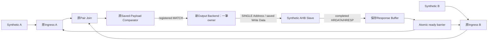

# Step 3E：Registered Output Gate + Atomic Response Distribution

## 結果與支援範圍

**SINGLE/NONSEQ 版本實作與驗證 PASS**。起點/最終 branch `ahb-lockstep-step3`，HEAD `effe1a897de3c6e13dc10fd84c8a00c915f4951f`。沒有 commit/push，沒有第二Core或SoC整合。

本版真正建立 saved registered MATCH → 單一 AHB-Lite master → response buffer → A/B ingress 的功能路徑，不是Step2組合pass-through。只支援合法SINGLE/NONSEQ、32/64-bit data、自然對齊且size不超過bus width。Read/Write與各byte lane均有runtime驗證。

**Burst/SEQ/Lock尚未支援**，以及過大size／未對齊request，會在任何有效downstream Address前以sticky policy fault拒絕，絕不偷偷改成SINGLE。沒有burst context／BUSY scheduler、WRAP/INCR8、Atomic/CMO policy或一拍一筆的pipelined downstream dispatch。測試中的INCR8/SEQ案例是「拒絕且零side effect」PASS，不是burst執行PASS。上游IDLE/BUSY不形成token；upstream release＋next Address同緣有實測。Downstream old Data與next IDLE Address重疊，**不支援兩筆有效downstream Address/Data pipeline重疊**。

證據主目錄：`artifacts/ahb-lockstep-step3e/run-002/`。三組Gate runtime、獨立atomic response-fork測試與原Step3B/C/D regression全部PASS，零build warnings，git diff --check PASS。

## Architecture / Protocol Preflight

核對原Step3A/B/C/D文件與實際RTL、controller/bridge/ram行為：

- 原Ingress每側只有一個pending；Read Address後OFFER，Write下一拍capture data/strobe後OFFER。Pair handoff兩側一起進WAIT_RESPONSE。Response最早下一edge才可接收；正常capture後release，Error則ERROR_1/ERROR_2。
- 原Pair只做原子join，不比較payload；pair_ready是consumer credit。Comparator保存兩份snapshot，registered MATCH才有match_valid；mismatch sticky fault無正常valid。
- req_seq/pair_seq是同reset interval的ordinal，沒有response epoch/tag。現有metadata在**單一outstanding、共同reset flush全路徑**條件下足夠；不需要修改既有介面。未支援任意延遲的跨reset stale slave response。
- AHB Address接受只在HTRANS[1]&&HREADY，下一個Data phase完成不能拿同一次Address ready當作自己的response。Write Data/Strobe須保持到Data完成，不由目前HWRITE遮罩。原AHB/APB bridge也直接使用Data phase HWDATA/HWSTRB。
- 原模組只保存burst metadata，沒有下游burst master/context，故本版保守限制SINGLE而非假裝既有介面已完整支援burst。
- 原EBU未使用HRESP，故本版error replay只保證AHB-visible正確，不能宣稱CPU trap/recovery。

## Detailed Architecture / Dataflow



新增 `ahb_lockstep_guard.sv` 作standalone top，實例化原dual_ingress/pair/comparator及新 `ahb_lockstep_output.sv`。不修改原3B/C/D格式或功能，不接SoC。Backend有獨立owner_addr/write/size/prot/wdata/strb/seq、saved response與release flags。owner從registered Comparator的saved A取得，不讀live A/B bus。

Backend持有owner直到兩側upstream completion，而非只等downstream completion或internal response capture。由於只有一筆outstanding且同一pair才可dispatch，不需以live HTRANS尋找response收件人，也不會讓B重做Memory request。

### 授權條件與FSM

```text
supported = burst==SINGLE && trans==NONSEQ && lock==0
            && size<=log2(DATA_WIDTH/8) && naturally_aligned(addr,size)
match_ready = resetn && EMPTY && !compare_fault && !gate_fault
              && (M_HREADY || !supported)
authorized_dispatch = match_valid && match_ready && supported
policy_reject = match_valid && match_ready && !supported
```

Bus原先HREADY=0時，不可改動包含IDLE在內的輸出。因此合法MATCH在EMPTY會先等待HREADY=1才轉移到ADDRESS，保存Comparator結果作consumer backpressure。Unsupported可在不改bus輸出的情況下fault-receive，不必等待slave恢復ready。

| Backend State | Downstream / response | 下一步 |
|---|---|---|
| EMPTY | HTRANS=IDLE；依上式提供match_ready | 合法MATCH保存owner→ADDRESS；unsupported→HALTED |
| ADDRESS | NONSEQ、saved control/data保持；不由live bus驅動 | HREADY=1只記一次Address acceptance→DATA |
| DATA | next Address為IDLE、HWRITE=0；前筆saved Write Data/Strobe保持 | HREADY=1保存response→RESPONSE；HREADY=0繼續保持 |
| RESPONSE | buffer保持，等兩側rsp_ready | 同緣交付兩側一次→RELEASE |
| RELEASE | 無新有效downstream Address；保留owner等A/B completion | 兩側完成後→EMPTY；若sticky error/fault→HALTED |
| HALTED | HTRANS=IDLE、無normal dispatch | 只由共同reset恢復 |

地址接受後立即離開ADDRESS，故即使HREADY長期高也不重送。DATA期間HWRITE=0是**下一個IDLE地址**的方向，不是前筆Write Data被遮罩。Stall時整組master address/control/data/strobe逐edge穩定性有assertion。

## A/B Response Distribution

Downstream只在DATA&&HREADY時保存HRDATA和HRESP。Error第一周期HRESP=1/HREADY=0也會記錄error_seen，避免先見Error後誤報成功。合法slave error模型為第一周期ready0/resp1、第二周期ready1/resp1；完成後再由Ingress重建兩周期上游error。

`A_rsp_valid = B_rsp_valid = RESPONSE && A_rsp_ready && B_rsp_ready`，data/resp均來自同一buffer，不是live下游值。

| response_pending | A_ready | B_ready | A_valid/B_valid | Capture |
|---:|---:|---:|---|---|
| 0 | 任意 | 任意 | 0/0 | 無 |
| 1 | 0 | 0 | 0/0 | 無，buffer保持 |
| 1 | 1 | 0 | 0/0 | 無，不能只送A |
| 1 | 0 | 1 | 0/0 | 無，不能只送B |
| 1 | 1 | 1 | 1/1 | 同一edge各一次，離開RESPONSE |

這個內部barrier刻意依賴兩側ready；原Ingress的rsp_ready只依WAIT_RESPONSE，不依valid，故沒有ready/valid組合循環。不是可任意接到ready依賴valid的consumer的通用fork。獨立fork test把B_ready保持0三cycles，證實A也不提前消耗；B恢復後兩側恰好各一次，payload不被live HRDATA改變。

正常capture後兩側Ingress同進RELEASE_OK，下一個edge各完成一次。Error capture後同進ERROR_1（ready0/resp1），再到ERROR_2（ready1/resp1）完成。Backend還保留A/B finished flags；release時序不一致會sticky diagnostic，不作新的正常dispatch。

**實測zero-wait Read**（均為edge前事件）：

| ps | Event |
|---:|---|
| 35 | A/B upstream Address接受 |
| 45 | Pair handoff，Comparator保存snapshot |
| 55 | Registered MATCH authorized dispatch |
| 65 | Downstream Address接受 |
| 75 | Downstream Data完成，保存buffer |
| 85 | A/B同緣internal response capture |
| 95 | A/B同緣AHB completion |

B沒有對Shared Uncore發第二筆request，但收到與A完全相同的saved read data/status/completion timing。

## Fault / Reset Policy

- Comparator mismatch：保留原11-bit reason/snapshots，禁止MATCH dispatch，沒有downstream acceptance或假response，兩側pending停等共同reset。
- Backend policy fault（gate_fault bit0）：已接收等值但不支援的metadata，沒有authorized dispatch／downstream Address；停等reset，不回成功。
- Downstream Error（bit1）：先保存真實error並正常分送／完成兩側的兩周期error，再HALT。Fault不會把該已完成合法交易的error response擋住。之後禁止新dispatch。
- Release skew／非法backend state（bit2）：sticky fault，禁止後續正常dispatch；沒有rollback/retry保證。
- Error第二周期可同緣接受下一Address。原Ingress仍會正確保存它；top禁止新pair進Comparator，作quarantine到共同reset，沒有忽略已發生的Address handshake。Read/Write error測試皆驗證此行為。
- Reset共同清除Ingress/Pair/Comparator/backend與slave pending。若Address還未被接受，不會有下游副作用；若已被接受／完成，**不能保證撤回slave已做的效果**。測試write已完成但response buffer被reset後，RAM內容仍在，之後Read驗證保存的prefix；不宣稱rollback。

Common reset必須flush外部slave。無tag/epoch的目前介面無法辨認任意晚到的舊response；單owner與共同reset是必要integration contract。slave永久stall則不產生假完成，沒有新增timeout。Source須遵守合法AHB與byte-enable範圍；本版不是完整source protocol checker。

## Unit Latency / Wait 定義

由新Python離線ledger從 `guard-events.csv` 的rising-edge **pre-NBA** 訊號重播，edge index相減，不用wall-time除法或$finish。這是unit measurement，不改原 `reset_release_to_tb_complete_v1` 或Performance Baseline。

事件：U_A/U_B=各側Address acceptance；P=首次pair_valid可見的edge（兩份完整request ready）；C=pair_valid&&pair_ready handoff；D=authorized_dispatch；A=down_accept；E=down_complete；R=兩側internal response capture；F_A/F_B=各側pending&&HREADY completion。

報告 P→D、C→D、D→A、A→E、E→F_A/F_B、U_A/U_B→F_A/F_B。同edge舊completion先結算再接受新Address。只有端到端完成的pairs進latency aggregate；reset/reject/部分完成保留獨立transactions/cancelled JSON，不混入平均。

每edge另外獨立計數：peer_wait=A_req_valid XOR B_req_valid；consumer_backpressure=match_valid&&!match_ready；address_backpressure=address_phase&&!M_HREADY；data_wait=data_phase&&!M_HREADY（包含Error第一周期）；response_backpressure=response_pending且本edge沒有雙側capture。Wait總數跨測試epochs由trace累加，與原reset-interval Pair counter語意相同取樣，但不修改該counter。

### RV64實測，單位cycles

| Completed案例 | P→D | D→A | A→E | E→A/B完成 | A端total | B端total |
|---|---:|---:|---:|---:|---:|---:|
| zero-wait Read | 1 | 1 | 1 | 2 | 6 | 6 |
| A early3 + data wait2 | 1 | 1 | 3 | 2 | 11 | 8 |
| B early2 + address wait2 / data wait1 | 1 | 3 | 2 | 2 | 9 | 11 |
| consumer stall3（此例data wait1） | 4 | 1 | 2 | 2 | 10 | 10 |
| zero-wait Write | 1 | 1 | 1 | 2 | 7 | 7 |
| Write address wait3 / data wait4 | 1 | 4 | 5 | 2 | 14 | 14 |
| Read Error（普通wait2＋Error第一周期） | 1 | 1 | 4 | 3 | 10 | 10 |
| Write Error（普通wait1＋Error第一周期） | 1 | 1 | 3 | 3 | 10 | 10 |

23個完整pairs的min/mean/max：P→D=1/1.130435/4；D→A=1/1.217391/4；A→E=1/2/5；E→A/B完成=2/2.086957/3；A端total=6/8.130435/14；B端total=6/8.086957/14。平均包含本directed suite的error/wait設定，不能當一般應用平均。

RV64全epochs wait：peer8、consumer3、address7、data24；response fork在整合路徑0，獨立fork test另外3。Address7含reset取消前2cycles；data24含reset取消前1cycle。完整pairs latency中的data wait為23，不能把reset前等待混入完整beat平均。完整數據在各width的latency.json/latency.csv。

**這些不是CPU Cycle Overhead**。原Hello Original vs Step2 0%結論保留，沒有重跑或推論Step3E也是0%。

## Directed Verification / Regression

`guard_tb.sv` 使用synthetic A/B source與獨立single-outstanding AHB slave、byte RAM和shadow memory。每個有效Address保存metadata、Write下一拍捕捉Data/Strobe；每個downstream acceptance核對已授權的saved A/B request。Read/write side-effect counters只在模型的合法Data completion執行一次；error模型不作新effect，這不是對所有真實slave的error atomicity保證。

Assertions：地址/資料stall穩定、accept/complete分離、唯一dispatch/accept/complete、每側response恰好一次、A/B timing/data/status一致、return data符合獨立shadow RAM、old-data/new-address同緣、reset cancellation與總數守恆。Offline ledger獨立重算生命週期、latency、wait與side-effect counts，並與simulation PASS counters交叉核對。

| Runtime width ADDR/DATA/STRB | Pairs | Authorized | Down accept/complete | A/B各complete | A/B cancel | 模型Read/Write effects | Errors |
|---|---:|---:|---:|---:|---|---|---:|
| 56/64/8 | 36 | 27 | 26/25 | 23 | 16/15 | 10/13 | 2 |
| 34/32/4 | 32 | 23 | 22/21 | 19 | 16/15 | 10/9 | 2 |
| 32/32/4 | 32 | 23 | 22/21 | 19 | 16/15 | 10/9 | 2 |

RV64每側accepted=completed+cancelled：A39=23+16、B38=23+15。多1個A cancellation是reset_pairing僅A接受。36pairs=23完成+8拒絕+5個reset取消；27authorized少1個在ADDRESS取消所以26 down accept，再少1個DATA取消所以25 down complete，再少2個response/release reset所以23 upstream complete。24個internal response forks包含1個fork後、AHB completion前reset，不能誤算成upstream成功。

涵蓋：simultaneous／A/B early、zero/multi wait、consumer和address/data backpressure、full-width Write、每個byte lane、halfword、write後read、最高Address bit、upstream write completion與next Read同edge、IDLE/BUSY、Read/Write兩周期Error與quarantine、address/data/strobe mismatch、unsupported Burst/SEQ/Lock/size/alignment、reset pairing／registered MATCH／address dispatch／data pending／response buffer／upstream release。

相同response透過Guard功能RTL回A/B，沒有test stub替Guard製造成功response。Standalone `output_fork_tb`僅測內部consumer readiness：一側unready3cycles時兩側0capture，恢復後各1capture，payload保持。

原Step3D regression482cases/461faults零正常dispatch；nested原Step3C 18pair/每側17complete/3cancel；原Step3B unit及single/cache controller regression均PASS，原檔案未修改。

## 實際命令 / Evidence Paths

工具Verilator `5.036 2025-04-27 rev v5.036`，clock高/低5ps，period10ps；--timing --trace --assert --timescale1ps/1ps，無新增warning suppression。

```bash
# run-001: preflight/preservation及零warning lint
verilator --lint-only --timing --assert --timescale 1ps/1ps --top-module guard_tb src/ebu/ahb_lockstep_ingress.sv src/ebu/ahb_lockstep_pair.sv src/ebu/ahb_lockstep_dual_ingress.sv src/ebu/ahb_lockstep_compare.sv src/ebu/ahb_lockstep_output.sv src/ebu/ahb_lockstep_guard.sv tests/ahb_lockstep/guard_tb.sv
# run-002: 三組width、fork、完整B/C/D regression與離線verification
python3 tests/ahb_lockstep/run_guard.py artifacts/ahb-lockstep-step3e/run-002
python3 -m py_compile tests/ahb_lockstep/run_guard.py tests/ahb_lockstep/summarize_guard.py
git diff --check
```

Runner對既存output目錄拒絕執行。所有build/sim/regression/verifier的argv/cwd/exitcode保存在*-command.json / *-result.json，width overrides與source snapshot/hash另存。Build沿用已確認ccache需sandbox外寫入的權限方式；本次無build/simulation/assertion失敗，無為通過測試而改動既定ROI或舊RTL。

RUN=`artifacts/ahb-lockstep-step3e/run-002`：

- summary.json、verification.log、source-sha256.json、source-snapshot、width-matrix.json、toolchain.json。
- rv64/rv32/explicit32對應build/simulation logs；runtime目錄內guard.vcd、guard-events.csv、transactions.json、cancelled-upstream.json、latency.json、latency.csv。
- fork-build.log、fork-simulation.log、fork/output-fork.vcd。
- step3d-regression及nested step3c/step3b的summary/logs/VCD。
- waveform-windows.json、final-verification.json、最終git-status／diff-check與working diff。

GTKWave設定 `docs/waveforms/ahb-lockstep-step3e/guard.gtkw`、fork.gtkw，已依實際VCD header核對訊號/寬度；未啟動GUI，未產生截圖。

| RV64 window ps | 內容 |
|---|---|
| 35–95 | zero-wait Read完整流水 |
| 345–445 | consumer idle backpressure3 |
| 605–745 | Write address stall3/data wait4 |
| 1625–1775 | old Write在1705ps完成並接受next Read，1775ps完成Read |
| 1785–1855 | address mismatch，無授權/下游effect/response |
| 2495–2635 | Read error、兩周期replay與next request quarantine |
| 3045–3115 | down3095ps已完成後reset response buffer，無upstream假完成 |

## Problems & Solutions / Limitations / Meeting

- 原metadata足夠實作single-owner／common-reset路徑；以owner register＋response buffer＋雙側release bookkeeping補上原設計尚無的功能，不修改Ingress/Pair/Comparator。
- 靜態preflight發現bus若原先HREADY=0，甚至IDLE輸出也要保持。因此合法MATCH先在Comparator backpressure等ready，再registered授權，與有效Address stall分開測／計數。不是以ready同時充當Address和自己的Data completion。
- Atomic response barrier防止A先消耗、B拿到後續response；因既有Ingress ready獨立valid，可安全使用。若未來改consumer契約，須重審barrier。
- Error已有合法downstream completion，仍必須回兩側error；sticky fault只擋新的normal dispatch，不得把error replay也擋住。Error release同緣新Address必須保存為quarantine。
- 7129個既有source/tests/docs/backups/evidence先保存hash，最終只允許meeting log追加並驗舊prefix，其餘7128不變。歷史work-* build cache未列入hash，也未重寫。config.ini與所有舊artifacts/未追蹤備份保留。

新增兩個RTL、guard_tb/output_fork_tb、runner/summarizer、新技術文件、兩份GTKWave設定；既有meeting log只追加。沒有commit/push、stash/reset/clean、Git設定修改。沒有非預期驗證錯誤。

限制：只完成SINGLE子集；未支援有效Burst/SEQ／downstream pipelined多筆，未接實際Uncore/RAM/APB、未跑真實Core。Slave model證據不是實際UART/FIFO、Error rollback或CPU recovery保證。32/64為實測寬度，其他width不宣稱支援；無四態注入/Formal/STA。Counter samples屬unit synthetic測試，非CPU benchmark。

Meeting可報告：registered MATCH前零下游effect、每筆一次Address/Data、B正確取得同份response、error/reset/mismatch policy清楚、byte lanes與寬度已驗證、unit latency/waits已有可重現JSON/CSV且舊3B/C/D無退步。下一步先擴充burst context/BUSY scheduler並以實際Uncore單Core外部wrapper驗證，再考慮雙Core受控SoC整合；不能將目前SINGLE PASS當完整INCR8支援。
