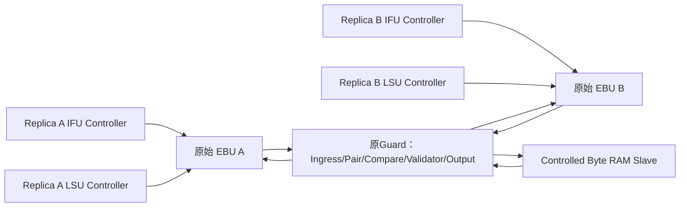

# Step 3F — EBU Compatibility Gate

## 目標／範圍

以兩側各一個**原始ebu**、各兩個原始ahbcacheinterface（IFU READ_ONLY_CACHE=1、LSU=0）及原始buscachefsm，經現有Guard驗證No-Fault情況。Cache端命令/Word及pipeline Stall由TB提供，AHB HTRANS/HADDR/HBURST/HWDATA/HWSTRB由原RTL產生；未建立假的EBU，也沒有直接改寫AHB輸出。

HEAD為8b4c9a1ef，Branch ahb-lockstep-step3。Configuration直接載入原rv64gc/shared headers，Assertions確認BURST_EN=1、512-bit Line、64-bit AHB與LLEN。原Core/IFU/LSU/Cache/EBU/Controller/Guard RTL與Configuration皆未修改。未執行F3、實際Shared Uncore、真雙Core或Fault Injection。F2b NOT_MET及full_F2_acceptance_complete=false保留。



EBU在**同一replica內**選擇IFU/LSU；Guard的A/B Pair/Comparator不是兩個Bus Master的競爭仲裁。

## 原始RTL與Interface

新增例化原始src/ebu/ebu.sv、ebufsmarb.sv、controllerinput.sv，以及counter、flopenl、flopr；Controller Gate已使用的cvw、ahbcacheinterface、buscachefsm、swbytemask、flopen/flopenr/mux原樣沿用。EBU .clk/.reset接共同時鐘與反相HRESETn，Controller .HREADY接原EBU的IFUHREADY/LSUHREADY；Guard的HRDATA如原設計同時連到同側兩個Controller。

IFU/LSU AHB第一次Ready可在同Edge前進，但外部只接受LSU Address；IFU第一個Address由SaveReg保存。因此Scoreboard分開追蹤Controller local_accept與EBU外部accept，不誤用live IFU BeatCount判定Saved Address。HPROT=2/3標示IFU/LSU，Write Data由LSU Data Path直接連接，不能依當前Address的Select解釋舊Data Owner。

## Arbitration State / Timing

| State/條件 | 原始規則 |
|---|---|
| IDLE且IFUReq與LSUReq都1 | NextState=ARBITRATE、LSUSelect1、IFUSelect0、IFUSave1 |
| ARBITRATE | IFURestore/IFUDisable1，IFU輸出採Saved Metadata |
| HREADY0 | Controller BeatCount/Delayed與相應資料保存；新Data未完成 |
| ARBITRATE且HREADY/FinalBeatD為1且非both | NextState=IDLE，選取Saved IFU Address，可同Edge完成舊LSU Data並接受IFU Address |
| 返回IDLE | IFU使用live下一地址，LSUDisable由IFUReqDelay避免重複請求 |

IFU若已先開始Burst，稍後LSU請求會受原LSUDisable影響；不能把LSU priority解釋成任意中途搶占IFU Burst。所有仲裁結果依原State/NextState規則判定。

獨立Replay核對5312筆雙側Arbitration樣本：IFU/LSU Select、Ready gating、Disable、State/NextState全部一致，無同時Select。每側7個Save、527個Restore cycles，527 cycles內Saved Address與已前進的live IFU Address不同，仍保存正確。14筆Saved Request皆只轉送一次。

### 實際Waveform例子（Replica A，both_read）

| Edge | 行為 |
|---:|---|
| 2595ps | IFUSave；LSU勝出；保存IFU Address 0x300 |
| 接下來100個Restore cycles | live IFU已為0x308，但IFUHADDROut維持0x300 |
| 3575ps | 最後LSU下游Data完成 |
| 3595ps | LSU上游Completion，Saved IFU Address接受；State返回IDLE |

這是**上游EBU/Guard介面**的Data/Address交接，不是F2b的下游Pipeline。PNG從本輪FST匯出渲染，非GTKWave GUI截圖；GTKWave設定已對照Header。

## Assertions / Scoreboard

- TB只驅動CacheBusRW/Adr/Word、BusRW/WriteDataM/Size及pipeline Stall。有限Stall/Skew由合法上層請求時程與Slave Wait提供，無Fault Injection。
- 每側IFU/LSU有獨立預期Beat/Completion/Ack；Saved Request按HPROT/Sequence追蹤，重複Address不可覆寫或重配。
- Pair前兩側完整Payload均存在且一致；Registered MATCH/Auth每Owner一次。
- 下游Address所有Metadata與Saved Owner完全一致；INCR8為NONSEQ+7SEQ、地址+8；BUSY不算有效Beat。
- Write Address接受後，原wdreg的下一Edge Data/Strobe必須與獨立預期Cache Word/Byte Mask相等；Wait期間保持。
- 每次Down Complete才更新一次Byte RAM；以獨立Shadow及完整4096 Byte Dump核對。
- Response Capture不能早於Down Complete，不可重複；A/B Response Data/Status與Owner一致。
- CacheBusAck只可對應該Source最後Beat7，且8筆Down Data均完成；同Edge新Address不可覆蓋舊Ack Owner。
- Fetch Buffer於Ack Edge的NBA後，與8個實際Read Response組成的512-bit期望值全數核對。
- 無進度500cycles、單Case2000cycles及絕對200000ps Watchdog；本輪皆正常結束。

## 實際結果

最終：artifacts/ahb-lockstep-step3f/ebu-gate-run-005/。27 cases全部PASS，236個完整唯一Owner；Pair/Auth/DownAccept/DownComplete/A/B Complete皆236。

| Source/類別 | Burst數 | Beats |
|---|---:|---:|
| IFU Refill | 12 | 96 |
| LSU Refill | 9 | 72 |
| LSU Writeback | 7 | 56 |
| LSU Uncached Read | — | 3 |
| LSU Uncached Write | — | 9 |

Read共171、Write共65。A/B各28 CacheBusAck（IFU12、LSU16），所有Ack比最後Down Data晚2cycles。21個Read Burst兩側共42份Fetch Buffer Snapshot完全一致。Writeback同一Line8個Word讀回、八個Byte Lane寫同一Word再讀回全部PASS；Uncached最終Word為0x1032547696b8dcfe。Actual/Expected Memory各4096 Byte一致。

| 代表Case | Beats | cycles | 結果 |
|---|---:|---:|---|
| IFU only / LSU read zero wait | 各8 | 各49 | PASS |
| LSU write zero wait | 8 | 57 | PASS |
| LSU writeback same-line readback | 8 | 84 | PASS |
| 同時IFU/LSU Read | 16 | 186 | PASS |
| 同時IFU/LSU Write | 16 | 192 | PASS |
| 同時IFU/LSU Uncached Read / Write | 各9 | 94/96 | PASS |
| IFU先、LSU後 / LSU先、IFU後 | 各16 | 169/188 | PASS |
| Replica A先 / Replica B先 | 各16 | 195/188 | PASS |
| A先且IFU先於LSU | 16 | 180 | PASS |
| IFU連續R/R、LSU連續R/R、W/R、R/W | 各16 | 168/169/178/176 | PASS |
| Burst後SINGLE、8 Byte Store、Uncached Readback | 各1 | 10～15 | PASS |

所有原始Case數據見cases.csv/json。Skew測試保留兩側相同的Cache端請求順序／相對時程，Replica偏移最長3cycles；不宣稱任意造成IFU/LSU交易重排的Skew也一定MATCH。

## Unit量測

| 指標 | 實測 |
|---|---:|
| Controller/EBU總Edge距離 | 2655 |
| Address Stall cycles | 423 |
| Data Stall cycles | 530 |
| BUSY cycles | 1470 |
| Peer Wait cycles | 8 |
| Pair/Consumer Backpressure | 0/0 |
| 最後Data Pending的Wait cycles | 59 |
| Beat Latency min/max | 1/5 |
| 下游Overlap | 0 |

總期間為最後sample cycle減第一個resetn有效sample cycle3；Case cycles為Driver end-start，個別Burst另存first/last資料。Address/Data Stall只統計各自Phase的M_HREADY0；BUSY為HTRANS01；Peer Wait沿用兩側完整req_valid XOR。Latency=down_complete-down_accept。全部是Unit層數據，不是CPU CPI/真雙Core Overhead，未改原Performance ROI。Response Barrier已核對236次兩側同步擷取及完成，本Gate沒有產生非零Consumer Backpressure；不假稱測到額外Barrier Credit Stall。

## 實際命令／Regression

```bash
python3 tests/ahb_lockstep/run_ebu_gate.py artifacts/ahb-lockstep-step3f/ebu-gate-run-005
python3 tests/ahb_lockstep/summarize_ebu_gate.py artifacts/ahb-lockstep-step3f/ebu-gate-run-005
python3 tests/ahb_lockstep/analyze_ebu_arbitration.py artifacts/ahb-lockstep-step3f/ebu-gate-run-005
python3 tests/ahb_lockstep/render_ebu_gate.py artifacts/ahb-lockstep-step3f/ebu-gate-run-005
git diff --check
```

Verilator5.036、--timing --assert --trace-fst --timescale1ps/1ps、Clock10ps；Lint/Build/Simulation全部PASS、最終Warning/Error0，無Suppression。完整argv/cwd/版本/exitcode保留。

本輪ebu-gate-regression-001重新執行F1 103cases、F2三組各37Owners、Step3B～3E全部PASS，以及Controller Gate DCache19cases/106、ICache6cases/42全部PASS。來源未變更。沒有將任何Gate結果改成F2b PASS。

## Problems & Solutions

1. run-001：新TB Monitor錯把IFUReqDelay放在ebu層；實際位於ebufsmarb，依原Source修正階層，保留原Error Log。
2. run-002：新TB Address期望式32/56-bit條件運算引發1個WIDTHEXPAND；各正整數Operand先擴成AW，再運算，不截斷資料。
3. run-003：Lint零Warning，Build因ccache sandbox Read-only失敗；獲准外部Build重跑。
4. run-004：首次Simulation 26cases/228筆全部PASS。為明確覆蓋Memory Readback，新增同Line Readback Case，Byte Stores改寫同Word逐Lane後Readback；不是為了掩蓋失敗而修改條件。
5. run-005：27cases/236筆全部PASS，獨立Replay/Save/Restore/Memory核對也PASS。無原EBU/Guard相容性失敗，不需修改功能RTL。

## Evidence與限制

Run保留Source Snapshot/SHA256、Build/Lint/Simulation Logs、events及arbitration CSV/JSON、beat-ledger、save-restore-ledger、ack-fetch-ledger、burst-metrics、metrics、memory Dumps、FST/VCD、GTKWave/PNG、技術文件、完整Codex回覆、Diff及Evidence ZIP。ZIP不包Generated Objects與大型FST，另提供Waveform路徑/SHA256。

本輪只新增EBU Gate TB/Runner/Replay/Arbitration Analyzer/Renderer與本文件，Meeting Log只追加。既有Controller Gate、F1/F2、config.ini及Backups/Artifacts保留；原功能RTL未改，沒有Commit/Push。

結論：No-Fault下，現有序列化Guard與原EBU/IFU/LSU Controller的已測情境相容，可進行下一輪F3設計/實作。實際Cache FSM/SRAM、真CPU、Shared Uncore、任意合法時序覆蓋、Flush/Interrupt、F3 Error/Fault Drain/Reset Recovery仍Pending；原EBU忽略HRESP，不宣稱CPU Recovery。本輪停止，不自行開始F3/3G/Fault Injection。
