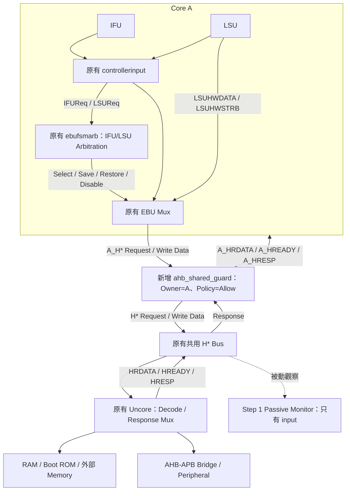

# Step 2 Meeting Report：A-only Shared Arbitration / Guard

## 成果狀態與 Git

**已實作並驗證**：A-only Shared Guard 組合直通、SoC 接線、獨立 Testbench、INCR8 中途 Stall、Hello Wally 與 Step 1 的完整 AHB Waveform 比較、BUS_SUPPORTED=0 runtime smoke，以及 rv32i/rv32e lint。

- 開發 Branch：`ahb-shared-guard-step2`，從 Step 1 Checkpoint 建立。
- 保留的 Baseline：`aebe53d12a1003791bd8f3d8823635aaa3d0330e`。
- Step 2：本報告隨本次 Git Checkpoint 提交；Commit message 為 `Add A-only shared AHB guard with verification`。Commit SHA 以包含本報告的 Checkpoint 為準；未 Push。
- 本次產物：`artifacts/ahb-shared-guard-step2/run-001/`，以下簡稱 RUN。
- `comparison.json` 為本次比較結果；`preserved-sha256.json` 記錄修改前既有檔案，124 個檔案最後皆通過雜湊驗證。

## 架構與責任



原有 IFU/LSU Arbitration 仍在 Core 內，由 `ebufsmarb` 完成。本次 Shared Arbitration 層只有 A 輸入，所以固定選 A；沒有新增競爭選擇 FSM。Comparator 不屬於此路徑，本次沒有加入 Comparator 或 Lockstep。

原有 EBU 仍產生 HCLK=clk、HRESETn=~reset。Shared Guard 只接收共同 HCLK/HRESETn，沒有產生、延遲或 gating。兩個 input 在本版刻意不參與組合資料路徑。

## RTL 與完整介面

新增 `src/ebu/ahb_shared_guard.sv`，參數為 ADDR_WIDTH、DATA_WIDTH、STRB_WIDTH；SoC 分別傳入 P.PA_BITS、P.AHBW、P.XLEN/8。

下表以 Shared Guard 為中心列出所有 ports：

| 上游 Input | 下游 Output | 寬度 |
|---|---|---:|
| A_HADDR | HADDR | ADDR_WIDTH |
| A_HTRANS | HTRANS | 2 |
| A_HWRITE | HWRITE | 1 |
| A_HSIZE | HSIZE | 3 |
| A_HBURST | HBURST | 3 |
| A_HPROT | HPROT | 4 |
| A_HMASTLOCK | HMASTLOCK | 1 |
| A_HWDATA | HWDATA | DATA_WIDTH |
| A_HWSTRB | HWSTRB | STRB_WIDTH |

| 下游 Input | 上游 Output | 寬度 |
|---|---|---:|
| HRDATA | A_HRDATA | DATA_WIDTH |
| HREADY | A_HREADY | 1 |
| HRESP | A_HRESP | 1 |

另有共同 Input：HCLK、HRESETn，各 1 bit。沒有額外 Request、Response、Owner 或 Allow ports。

重要位置：

- `ahb_shared_guard.sv:11`：完整介面。
- `ahb_shared_guard.sv:37`：Address/Control 逐訊號 assign。
- `ahb_shared_guard.sv:47`：Write Data/Strobe 無條件直通。
- `ahb_shared_guard.sv:51`：HRDATA/HREADY/HRESP 無條件直通。
- `wallypipelinedsoc.sv:80`：A_H* 中介接線。
- `wallypipelinedsoc.sv:90`：Core 改接 A_H*；HCLK/HRESETn 原樣保留。
- `wallypipelinedsoc.sv:98`：BUS_SUPPORTED=1 實例化新 Shared Guard。
- `wallypipelinedsoc.sv:108`：BUS_SUPPORTED=0 使用明確旁路，連接全部輸出與上游 Response。
- `wallypipelinedsoc.sv:116`：既有 Passive Monitor 繼續接下游 H*。
- `wallypipelinedsoc.sv:128`：Uncore 接線維持原樣。

Address Phase 和 Data Phase 可以重疊，例如當前 HWRITE=0 的 Read Address Phase，與前一筆 Write Data Phase 同時存在。HWDATA/HWSTRB 因此不能依當前 HWRITE 或 HTRANS 遮罩。獨立 Testbench 明確用這種情境檢查。

HREADY=0 時，原有 Core 與 Uncore 負責延長 Data Phase；新 Shared Guard 將 HREADY=0 原樣回傳，並持續傳遞資料。HRESP 在 HREADY=0 的 Error Response 第一周期也原樣可見。

Owner 固定 A，所以不需要功能性 Owner register；未來 Core B 的 Address Owner 與 Data Owner 必須分開保存，**這是後續設計計畫，尚未實作**。本版沒有 FIFO、Transaction Buffer、額外 Stall、Burst 轉換或重送。

## 修改檔案

RTL：

- 新增 `src/ebu/ahb_shared_guard.sv`。
- 修改 `src/wally/wallypipelinedsoc.sv`。

新增測試／工具：

- `tests/ahb_shared_guard/shared_guard_tb.sv`：獨立 stimulus、逐訊號透明性 assertions、Data Phase scoreboard。
- `tests/ahb_shared_guard/no_bus_tb.sv`：rv32i 的 BUS_SUPPORTED=0 runtime smoke。
- `tests/ahb_shared_guard/no_bus_dpi.cpp`：僅供 smoke top 使用的 getenvval DPI adapter。
- `tests/ahb_shared_guard/verify_step2.py`：完整 Baseline 比較、Monitor Log 核對、既有檔案雜湊保護及成功標記檢查。

新增報告／展示設定：

- 本報告 `docs/ahb-shared-guard-step2.md`。
- `docs/waveforms/ahb-shared-guard-step2/unit-burst-stall.gtkw`。
- `docs/waveforms/ahb-shared-guard-step2/read-burst-stall.tcl`。
- `docs/waveforms/ahb-shared-guard-step2/write-burst-stall.tcl`。

未修改 ebu.sv、ebufsmarb.sv、wallypipelinedcore.sv、uncore.sv、ahb_monitor.sv、tests/riscof/config.ini。Sail PATH 是工作目錄原先已有的變更，保留原樣。舊 Guard、Step 1 資料、VCD、GTKWave、Log 和備份均沒有覆蓋或刪除。

## 測試指令與結果

工具：Verilator 5.036。下列指令中的 ROOT=/home/tingniu94/cvw，RUN=$ROOT/artifacts/ahb-shared-guard-step2/run-001。

這些指令記錄本次實際執行內容；重跑請使用新的 run-002 等目錄並建立 unit/、hello/logs/、no-bus/，避免覆寫已保存的 Waveform 與 Log。

### Shared Guard 獨立 Testbench

```bash
verilator --binary --trace --timing --assert --timescale 1ps/1ps \
  --top-module shared_guard_tb --Mdir "$RUN/work-unit" \
  "$ROOT/src/ebu/ahb_shared_guard.sv" \
  "$ROOT/tests/ahb_shared_guard/shared_guard_tb.sv" \
  > "$RUN/unit-build.log" 2>&1
(cd "$RUN/unit" && "$RUN/work-unit/Vshared_guard_tb" > "$RUN/unit.log" 2>&1)
```

結果：`SHARED_GUARD_TEST_PASS`。

- 22 個有效 Address 被接受，21 筆完成，1 筆在 Reset 中取消。
- 11 Reads、10 Writes、9 個 pending Data Phase wait cycles、1 筆 Error Response。
- INCR8 Read：8 beats 完成，中間一筆 3 個 Wait Cycles。
- INCR8 Write：8 beats 完成，中間一筆 2 個 Wait Cycles。
- IDLE/BUSY、Read/Write 連續交易、HWRITE=0 時前筆 Write Data、Reset、兩周期 Error Response 均通過。
- 所有 request/data/response 在下一個 clock edge 前就檢查相等，驗證沒有新增一拍延遲。
- Waveform：`RUN/unit/shared_guard.vcd`，結束時間 430 ps。

### Hello Wally

為保留 Step 1 的 binary、VCD 與 Log，使用原 Makefile 的獨立 WORKDIR，並從新 runtime 目錄執行。

```bash
WALLY="$ROOT" make -C "$ROOT/sim/verilator" \
  WALLYCONF=rv64gc TESTBENCH=testbench PARAM_ARGS=MAKE_VCD=1 \
  WORKDIR="$RUN/work-hello" > "$RUN/hello-build.log" 2>&1
(cd "$RUN/hello" && WALLY="$ROOT" RISCV=/opt/riscv \
  "$RUN/work-hello/Vtestbench" +TEST=hello_hello \
  +ElfFile="$ROOT/examples/C/hello/hello" +AHB_MONITOR_LIMIT=0 \
  +UART_LOG=1 +UART_LOG_FILE=logs/hello_step2_uart.out \
  > "$RUN/hello.log" 2>&1)
python3 tests/ahb_monitor/extract_bus.py \
  "$RUN/hello/testbench.vcd" "$RUN/hello-decoded"
python3 tests/ahb_shared_guard/verify_step2.py \
  backups/ahb_guard_before_passive_step1/validation/monitor "$RUN"
```

最後一個指令以 exclusive-create 寫入 comparison.json，避免覆蓋既有結果；重跑驗證也應使用新的 run 目錄。

| 比較項目 | Step 1 | Step 2 | 結果 |
|---|---:|---:|---|
| Hello Wally 與 0–9 | 正常 | 正常 | 一致 |
| 結束時間 | 116160 ps | 116160 ps | 一致 |
| Clock 上升緣，含 Reset | 11617 | 11617 | 一致 |
| 完成 Transaction / beat | 1541 | 1541 | 一致 |
| Read | 1504 | 1504 | 一致 |
| Write | 37 | 37 | 一致 |
| pending Data Phase Stall cycles | 1253 | 1253 | 一致 |
| 全部 14 個 AHB 訊號變化與時間戳 | Baseline | 逐項比對 | 完全一致 |
| Monitor 紀錄 | 1541 筆 | 1541 筆 | 每筆欄位一致 |

標準化 Bus events SHA-256：

`516632f3004ce8445e73541b2b726a2059d2754bdc42d11eae97751f87eab3eb`

對比的是原有 HCLK、HRESETn、HADDR、HWDATA、HWSTRB、HWRITE、HSIZE、HBURST、HPROT、HTRANS、HMASTLOCK、HRDATA、HREADY、HRESP 的所有變化及時間戳。新增 hierarchy 會改變 VCD identifier，因此不是拿整份 VCD 檔案的 SHA-256 比較。

原 Testbench 仍印出 `Single Elf file tests are not signatured verified.`；本次未宣稱 ISA signature 或 Lockstep 驗證。

### BUS_SUPPORTED 分支

- rv32i：BUS_SUPPORTED=0，原有完整 testbench lint/elaboration 通過。
- rv32e：BUS_SUPPORTED=1，原有完整 testbench lint/elaboration 通過。
- rv64gc：BUS_SUPPORTED=1，Hello Wally runtime 通過。
- rv32i：新增 no_bus_tb runtime smoke 通過。在解除 Reset 後切換外部 Response，所有共用 Bus 輸出及 A 側 Response 都維持零值。

完整 lint 指令保存在 RUN/lint-rv32i-command.txt 與 RUN/lint-rv32e-command.txt。成功 no-bus build 的完整 argv 保存在 RUN/no-bus-command-final.json，使用原有 src 與 Ethernet source globs，加上 no_bus_tb.sv/no_bus_dpi.cpp。

實際執行 no-bus binary：

```bash
(cd "$RUN/no-bus" && WALLY="$ROOT" RISCV=/opt/riscv \
  "$RUN/work-no-bus/Vno_bus_tb" > "$RUN/no-bus.log" 2>&1)
```

結果：`NO_BUS_TEST_PASS`，結束時間 165 ps。沒有懸空 A_HRDATA/A_HREADY/A_HRESP；兩個 generate 分支互斥，不會重複驅動共用輸出。新的直通路徑只朝 request-forward/response-return 方向，不產生額外組合回授。

## Waveform 與 Meeting 展示

### 新增的 Burst Stall 範例

使用 RUN/unit/shared_guard.vcd，timescale=1 ps：

| 範例 | Address 接受 | Data 完成 | Wait Cycles | 重要資料 |
|---|---:|---:|---:|---|
| SINGLE Write 0x400 | 85 ps | 125 ps | 3 | HWDATA=0x4444 |
| Error Read 0x500 | 135 ps | 155 ps | 1 | HRDATA=0x5555、HRESP=1 |
| INCR8 Read beat 2，0x1010 | 185 ps | 225 ps | 3 | HRDATA=0x102 |
| INCR8 Write beat 2，0x2010 | 305 ps | 335 ps | 2 | HWDATA=0x202、HWSTRB=0xff |

Read Burst：第一個 Address 在 165 ps 接受，最後 Data 在 275 ps 完成；Wait 邊緣為 195/205/215 ps。HREADY 低值區間為 [190,220) ps；在 225 ps 上升緣完成 stalled beat，同時接收下一筆 SEQ address。

Write Burst：第一個 Address 在 285 ps 接受，最後 Data 在 385 ps 完成；Wait 邊緣為 315/325 ps。HREADY 低值區間為 [310,330) ps，在 335 ps 完成 stalled beat。

GTKWave 可對照 A 側與共用側訊號：

```bash
gtkwave "$RUN/unit/shared_guard.vcd" \
  docs/waveforms/ahb-shared-guard-step2/unit-burst-stall.gtkw \
  -S docs/waveforms/ahb-shared-guard-step2/read-burst-stall.tcl
```

Read 特寫為 150–280 ps；換用 write-burst-stall.tcl 可看 280–390 ps。設定檔已靜態核對 VCD 訊號名稱，尚未啟動 GTKWave GUI 做視覺檢查。

### Hello Wally 範例

使用 RUN/hello/testbench.vcd，時間與 Step 1 相同：

- Read Burst：建議 5050–5160 ps；第一筆 0x80000200 Address 在 5070 ps 接受，最後 Data 在 5150 ps 完成。
- UART LSR Read 0x10000005：Address 在 5220 ps 接受、5240 ps 完成，1 個 Wait Cycle。
- UART Write 字母 H：0x10000000；Address 在 5310 ps 接受、5330 ps 完成，HWDATA=0x4848484848484848、HWSTRB=0x01。

這些 Hello Wally 的 Burst 本身沒有 Stall；新增的「Burst 中途 Stall」證據來自獨立 Testbench，兩者不可混稱。

**截圖路徑：尚未產生截圖，本次未啟動 GUI。** 已保留 Waveform、GTKWave 設定及精確時間供 Meeting 截圖使用。

## Warning、遇到的問題與限制

最終成功的 unit/Hello/no-bus Build 與 rv32i/rv32e lint **均無 Warning 或 Error**。Python 驗證工具 Ruff check 與 git diff --check 通過。

no-bus smoke 的前兩次 link 嘗試失敗：

1. 原有 IROM memory model 使用 getenvval，最初未連入 DPI implementation。
2. 補用原 wrapper.c 後，發現它固定 include Vtestbench__Dpi.h，不能直接用於 no_bus_tb top。

修正只新增 Testbench 專用 no_bus_dpi.cpp；沒有改寫原 RTL 或 wrapper。失敗 Log 分別保留於 RUN/no-bus-build.log、RUN/no-bus-build-with-dpi.log，成功 Log 為 RUN/no-bus-build-final.log。

尚未驗證／未實作：Synthesis/STA、四態 X/Z 模擬、Core B、動態 Arbitration/Owner Tracking、Policy Deny、Comparator、Lockstep、Output Gate、Rollback。HCLK/HRESETn 在純組合 Guard 中刻意不使用；未為隱藏 Warning 而加入 gating。

## 下一步

使用者已確認建立 Step 2 Git Checkpoint；本次只 Commit RTL、Testbench、驗證 Script、Meeting Report 和 GTKWave 設定，不 Push。大型 VCD、artifacts 模擬產物、backups 與 Sail 本機設定保留在本機，未納入 Checkpoint。後續架構變更另開 Step 設計與驗證。

未來若進入 Core A/B Shared Arbitration，需另外設計 Address Owner/Data Owner、Burst ownership、非 Owner Core 的等待／完成邊界。Comparator 是另一項比較功能，不屬於現有 IFU/LSU Arbitration，也沒有在本 Step 提前實作。
